# MultiParkingSystem: Complete Application Feature and Security Guide

**Prepared for technical presentation. Source review date: 12 October 2026.**

This guide explains the application as implemented in the repository: what a person enters, what the code does, what is stored, what can fail, and why the design helps. It deliberately excludes WAR packaging, build-system setup, infrastructure architecture and database connection mechanics. Database records and transactions are discussed only to explain application behavior.

The flowcharts use Mermaid. Open this file in a Markdown viewer that supports Mermaid. Source links are relative to this document. Statements about behavior are based on code inspection; they do not prove that a particular customer's database schema, provider account or credentials have been configured successfully. Example users, amounts and secrets are illustrative, not real credentials.

## Contents

- [1. Roles and application journeys](#1-roles-and-application-journeys)
- [2. Signup, login and access control](#2-signup-login-and-access-control)
- [3. Two-factor authentication](#3-two-factor-authentication)
- [4. Password and authenticator recovery](#4-password-and-authenticator-recovery)
- [5. Administration](#5-administration)
- [6. Parking and checkout](#6-parking-and-checkout)
- [7. Razorpay payments](#7-razorpay-payments)
- [8. Google configuration and Gmail](#8-google-configuration-and-gmail)
- [9. Facebook and WhatsApp](#9-facebook-and-whatsapp)
- [10. Hashing, encryption and security reasoning](#10-hashing-encryption-and-security-reasoning)
- [11. Application data and state relationships](#11-application-data-and-state-relationships)
- [12. Routes and feature coverage](#12-routes-and-feature-coverage)
- [13. Tests, limitations and reviewer questions](#13-tests-limitations-and-reviewer-questions)
- [14. Presentation and demonstration checklist](#14-presentation-and-demonstration-checklist)

## 1. Roles and application journeys

The application separates managing a parking business from operating the parking entrance and exit. A parking customer identified by vehicle and phone number does **not** have to be a registered application user to pay a native Razorpay payment link.

| Role | Implemented responsibilities | Important boundary |
| --- | --- | --- |
| `ADMIN` | Manage floors, slots, vehicle types, rates, user roles, blocks and integrations; inspect parking history and reconcile payments | Admin access does not automatically grant the ticket-assigner-only booking/create and checkout/pay actions |
| `TICKET_ASSIGNER` | Record vehicle entry, allocate a slot, search checkout, collect cash or initiate Razorpay and inspect parking records | Cannot change admin configuration |
| `USER` | User dashboard, authenticator/security settings and logout | The current user dashboard is not a customer self-service parking-booking portal |
| Public visitor/customer | Signup, login, recovery and authenticated-by-signature/capability payment callbacks | Public payment URLs still validate provider signatures or request-specific tokens as appropriate |

**Why:** separating responsibilities reduces accidental administrative changes by operational staff. Backend role checks matter even if a link is hidden on a page: someone can still type a URL manually.

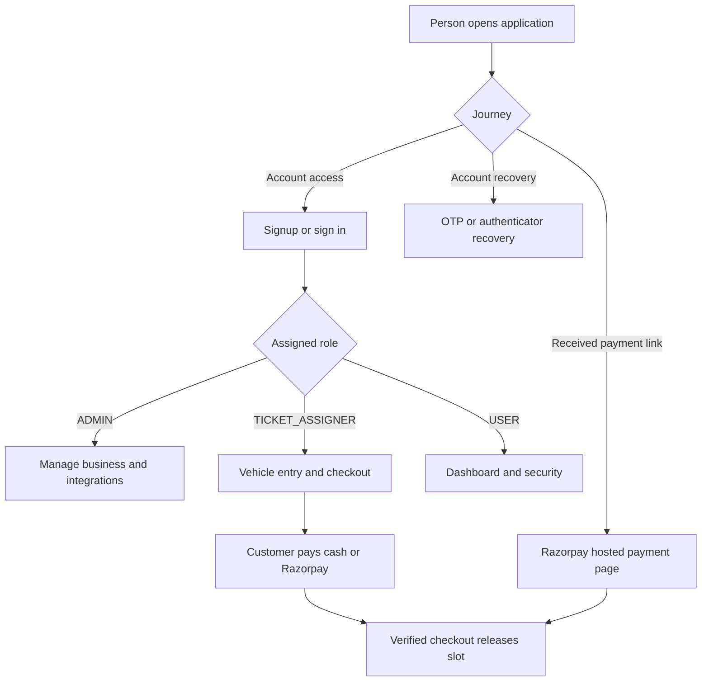

There is one business configuration per customer database in the current implementation. Do not claim that these tables implement shared-database tenant isolation; there are no tenant IDs on every application record.

## 2. Signup, login and access control

Primary sources: [AuthResource](../src/main/java/org/example/auth/AuthResource.java), [PasswordHasher](../src/main/java/org/example/auth/PasswordHasher.java), [JwtUtil](../src/main/java/org/example/auth/JwtUtil.java), [RolePageFilter](../src/main/java/org/example/filter/RolePageFilter.java) and [PageResource](../src/main/java/org/example/resource/PageResource.java).

### 2.1 Local signup

**Input:** name, email, phone number, password and confirm password, submitted to `POST /api/auth/signup` from the signup page.

1. Reject blank fields. The phone must contain exactly ten digits after trimming. Password and confirmation must match.
2. Start a transaction. Look for an existing email using a case-insensitive comparison.
3. Load the `USER` role. Public signup cannot choose `ADMIN` or `TICKET_ASSIGNER`.
4. Insert the person into `users` and bcrypt-hash the password into `local_auth`.
5. Commit both records together. Issue the normal authentication cookie and redirect to the user dashboard.
6. If an insert fails, roll back. Duplicate email returns a conflict; other database errors return a registration error.

**Why:** account details and credentials live in separate records, allowing local and Google authentication to use different identity information. The transaction avoids an account with half its authentication data missing. A bcrypt hash lets the app verify a password without storing recoverable plaintext.

**Actual boundary:** signup checks required fields, phone format and matching passwords; it does not enforce a strong-password length/complexity policy or verify email ownership through a signup OTP.

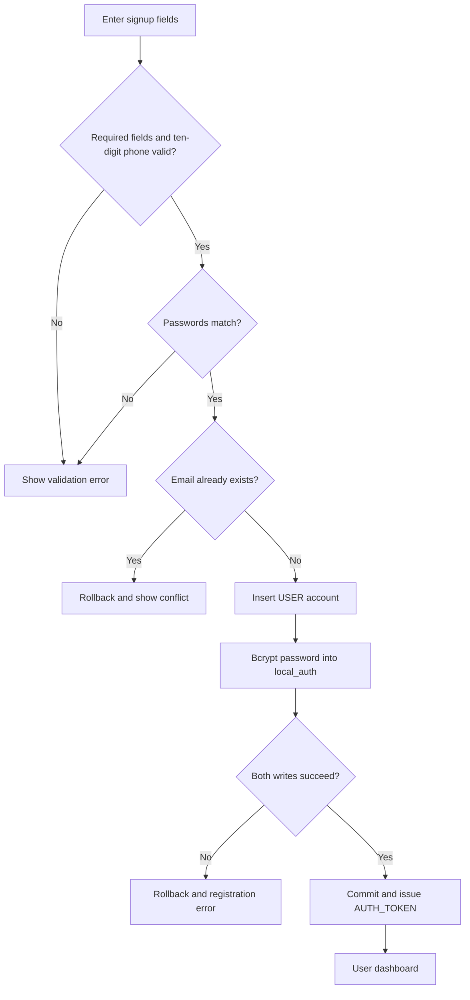

### 2.2 Password login: complete execution

**Input:** email and password to `POST /api/auth/login`.

1. Blank email/password produces HTTP 400: `Email and password are required.`
2. The code selects the matching `users`, `local_auth` and `roles` records using a prepared statement. This particular login query uses `u.email = ?`; it does not apply the signup query's `lower(...)` normalization.
3. If no local-login record is found, `PasswordHasher.burnTime("")` performs a dummy bcrypt check and the user receives HTTP 401: `Invalid email or password.`
4. If the record exists, the submitted password is checked against the stored bcrypt hash. The stored value is not decrypted. A mismatch returns the **same** HTTP 401 message.
5. The role and identity are loaded from the record. If 2FA is enabled, create a short-lived second-factor challenge; do not grant the normal session yet.
6. Otherwise, cancel open recovery requests through the login helper and issue the normal session cookie.
7. Redirect to the dashboard for `ADMIN`, `TICKET_ASSIGNER` or `USER`. An unknown role is forbidden. A database failure produces an internal-error response.

**Wrong-password example:** entering `wrong-password` for an existing local account executes bcrypt verification, returns the generic invalid-credentials page and creates no normal authentication session. This path has no implemented password-login failure counter or temporary password-login lockout. The 2FA and recovery attempt counters are separate protections.

**Why the generic message?** it avoids directly telling an attacker whether the email exists. The dummy bcrypt operation reduces the timing difference between an unknown email and a failed password, but it does not prove perfectly uniform response timing.

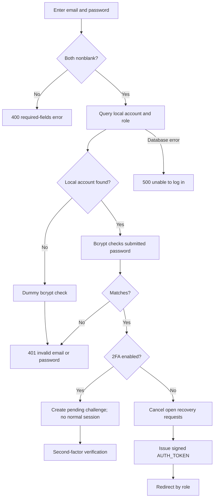

### 2.3 Google sign-in

The person selects Google login/signup. `GET /api/auth/google/start` loads the configured Google client and generates a ten-minute signed state containing a random value and selected mode. It requests `openid email profile`, which is different from Gmail mailbox permissions.

Google redirects to `/api/auth/google/callback`. The code validates the signed state's integrity/expiry, handles cancellation, exchanges the authorization code and verifies the ID token using `GoogleIdTokenVerifier` with the application's client ID as audience. It extracts Google's stable `sub`, email and name.

An existing Google identity in login mode signs in, with a second-factor challenge if that account enabled 2FA. An existing email that cannot be used through that identity is rejected with a conflict. **The code does not silently link a local-password account to Google just because their email addresses match.**

**Why:** the stable Google subject identifies the external account; token verification prevents trusting an arbitrary name/email from the browser. Keeping login methods distinct avoids unintended identity linking.

**Limitations:** the signed state in this login flow is not matched to an initiating browser cookie or single-use server record. A `nonce` exists inside state, but is not sent as an OpenID nonce and validated against the returned ID token. Do not describe this as the same browser-bound state validation used by all admin integration flows. An explicit `email_verified` check is not present in this callback.

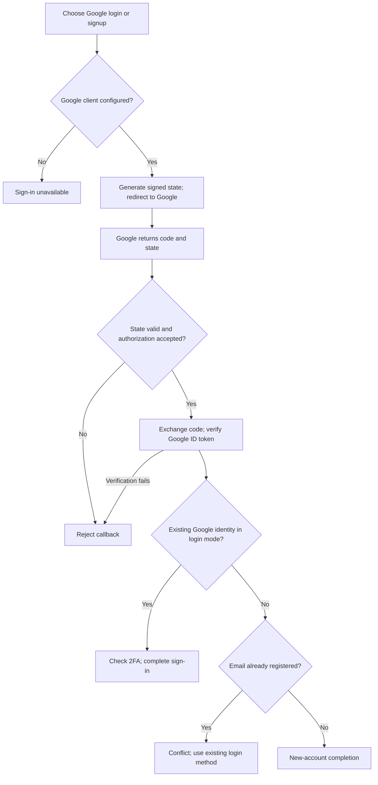

### 2.4 Google signup completion

For a new identity in signup mode, the app needs a saved customer phone. It puts `sub`, email and name into the ten-minute `GOOGLE_SIGNUP_PENDING` signed cookie and shows the phone form. `POST /api/auth/google/complete` checks the ten-digit phone and pending token, then creates `users` and `google_auth` records in one transaction. It stores the Google subject, not a Google password; clears the pending cookie and signs the user in as `USER`.

The new-identity login-mode path does not have the same explicit phone-form branch; do not demonstrate it as a guaranteed complete signup experience. The intended new-account demonstration should start with Google signup mode.

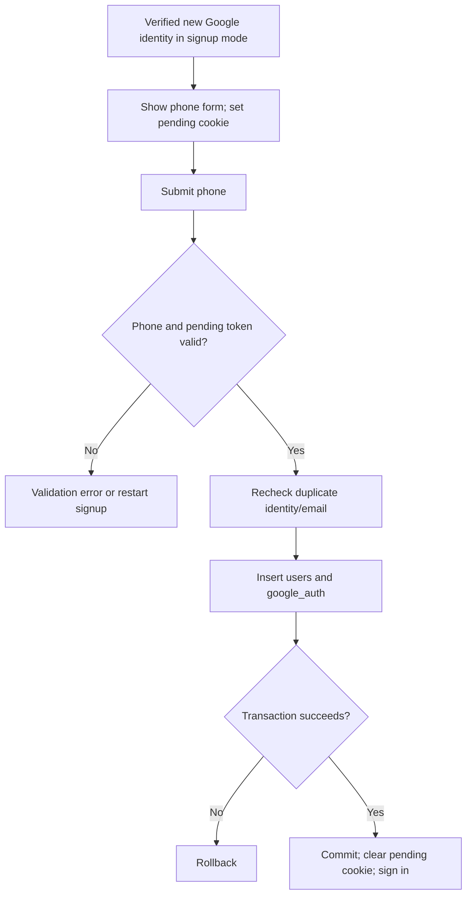

### 2.5 Session creation, expiry and protected access

`AUTH_TOKEN` contains `user_id`, name, email, role, issued-at time and expiry. Its lifetime and cookie `Max-Age` are two hours. The cookie uses `HttpOnly`, `Secure`, `SameSite=Lax` and path `/`.

`JwtUtil` produces `Base64url(payload).Base64url(HMAC-SHA256 signature)`. Despite the class name, this is a custom **two-part signed token**, not a standard JWT with header/payload/signature. The payload is readable after decoding; it is not encrypted. No password or provider token belongs in it.

On protected requests, `RolePageFilter` verifies the cookie and installs the identity/role into `SecurityContext`. Registered `RolesAllowedDynamicFeature` evaluates `@RolesAllowed`. Dashboard links are navigation; backend checks are the authorization boundary. `/api/auth/me` returns basic current-user claims if the token verifies and HTTP 401 otherwise.

**Why stateless?** the same signed identity can be verified without storing a login session in a single application's memory. **Tradeoff:** role changes and password changes do not immediately invalidate previously issued tokens; the filter trusts the role in the token rather than reloading it on every request. Expired tokens fail verification. `JwtUtil` rejects when `now > exp`, so the exact expiry second is accepted by its implementation.

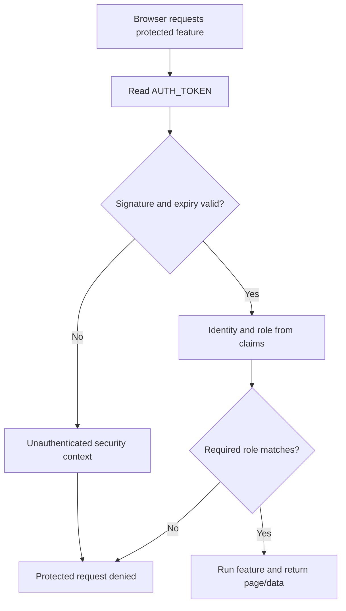

### 2.6 Dashboards and logout

`PageResource` serves separate role-protected pages. The admin page includes business/integration management links; the ticket assigner page links parking work; the user page currently exposes security settings and logout. Page resources replace the base-URL placeholder in the HTML template.

`POST /api/auth/logout` returns a redirect to login with expired `AUTH_TOKEN` and `AUTH_2FA_PENDING` cookies. It is client logout, not central revocation of every copy of the signed token.

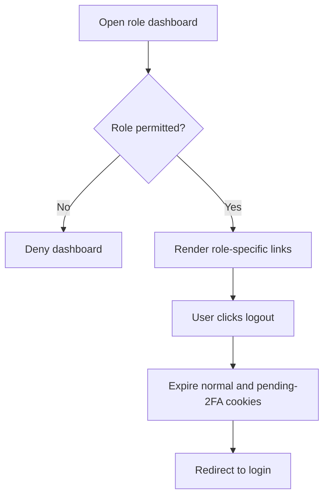

### 2.7 Default administrator account

[AppStartupListener](../src/main/java/org/example/listener/AppStartupListener.java) can create the initial administrator when the required administrator account values are supplied. It checks whether the email already exists, finds the `ADMIN` role, inserts `users` and a bcrypt `local_auth` record in one transaction and skips existing accounts. It does not reset an existing admin's password on each start or promote an already existing email automatically.

**Why:** the first administrator is needed before roles and integrations can be managed; ordinary public signup remains a `USER` operation.

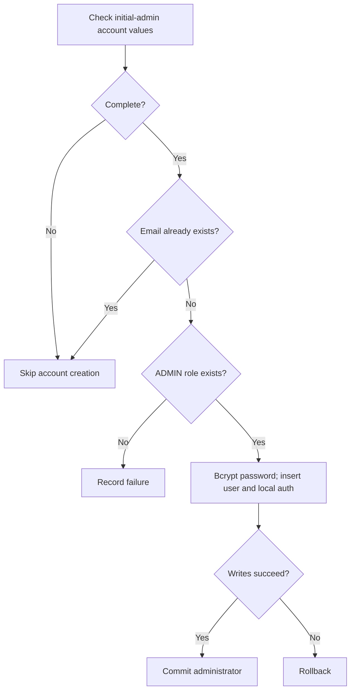

## 3. Two-factor authentication

Sources: [TwoFactorResource](../src/main/java/org/example/auth/TwoFactorResource.java), [TwoFactorService](../src/main/java/org/example/auth/TwoFactorService.java) and the second-factor actions in [AuthResource](../src/main/java/org/example/auth/AuthResource.java).

### 3.1 Enrollment and QR generation

The signed-in person opens `/api/auth/totp` and starts setup. The app checks the authentication cookie, generates 20 random bytes as a Base32 secret, AES-GCM encrypts it into `pending_secret_ciphertext` and gives it ten minutes of validity. It generates an `otpauth://` URI with issuer `MultiParkingSystem`, six digits, SHA1 and 30-second periods. ZXing renders the QR locally; the secret is not sent to an external QR-code generator.

The user scans the QR or manually enters the Base32 key into a compatible authenticator. Scanning alone does not enable 2FA. Existing enabled-factor status is checked by the resource before normal enrollment.

**Why:** confirming a live code proves that the person actually configured the authenticator. Encrypted pending data supports a multi-step setup without storing the secret as plaintext.

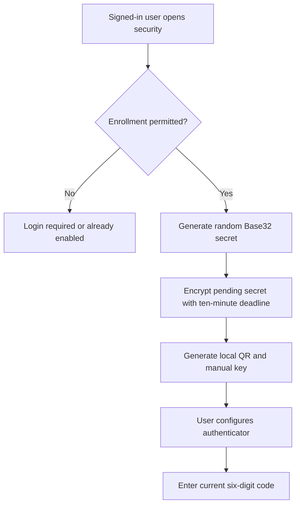

### 3.2 Enabling 2FA

`POST /api/auth/totp/enable` locks the pending factor record. Expired/missing enrollment or an incorrect code fails without activating it. A correct code promotes the encrypted pending secret to active secret, clears pending fields, records the accepted TOTP counter and creates ten recovery codes. The transaction commits before the plaintext recovery codes are shown once.

**Why:** the factor and backup codes must agree on activation; partial activation could lock a user out. Recording the accepted counter prevents that setup code from being reused immediately as a login code.

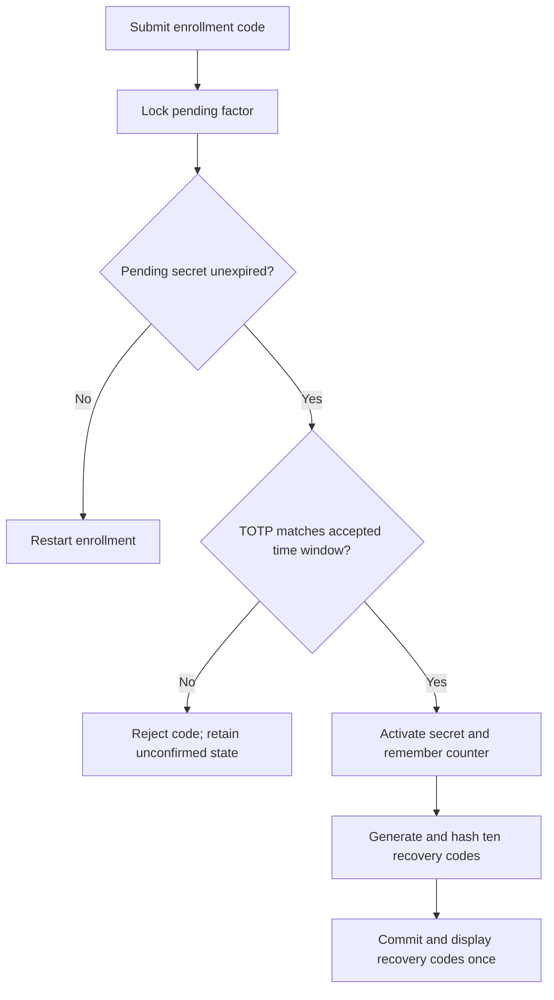

### 3.3 Second-factor login

Correct password or an existing valid Google identity is only step one when 2FA is active. The app creates a UUID challenge in `two_factor_login_challenges`, invalidates older challenges for that user and issues `AUTH_2FA_PENDING` with purpose `two-factor-login`. It clears the ordinary authentication cookie. The challenge/pending token lasts five minutes.

Verification accepts an unused recovery code or a six-digit TOTP whose matching counter is newer than `last_totp_counter`. The service locks factor and challenge records so simultaneous requests cannot consume the same challenge/code twice. A successful challenge is marked consumed, counters/lock are cleared, and the normal session is issued only after user/factor checks.

Wrong codes increment the challenge and account's factor-failure counters. Five incorrect attempts consume that challenge. At ten accumulated failed factor attempts, the account's factor login is locked for fifteen minutes. Expired, consumed and locked challenges are rejected.

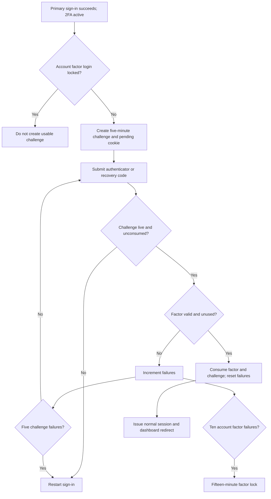

### 3.4 Recovery-code use and replacement

Each generated backup code has twelve characters from an ambiguity-reduced 32-character alphabet, displayed as two groups of six. The service removes hyphens/spaces and uppercases before SHA-256 hashing. Only hashes and `used_at` are stored. A matching unused hash is atomically marked used.

`POST /api/auth/totp/recovery-codes` requires a signed-in user and a valid authenticator/recovery factor. It deletes old recovery records and generates ten replacements in the transaction. Replacing them invalidates all previous unused codes. There is no endpoint that reveals the original plaintext codes again.

**Why SHA-256 here rather than bcrypt?** these are high-entropy machine-generated values rather than common human passwords. A fast hash is suitable for lookup when the original value is infeasible to guess; the same reasoning does not make SHA-256 suitable for human passwords.

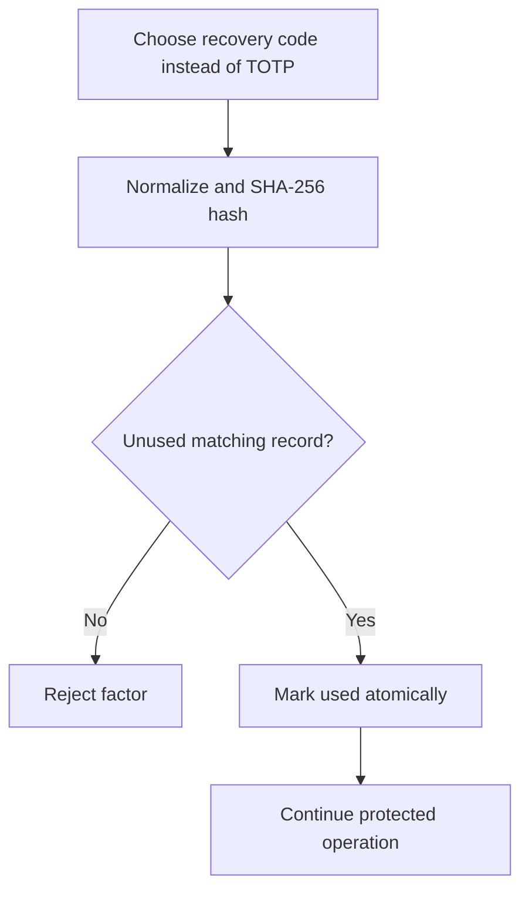

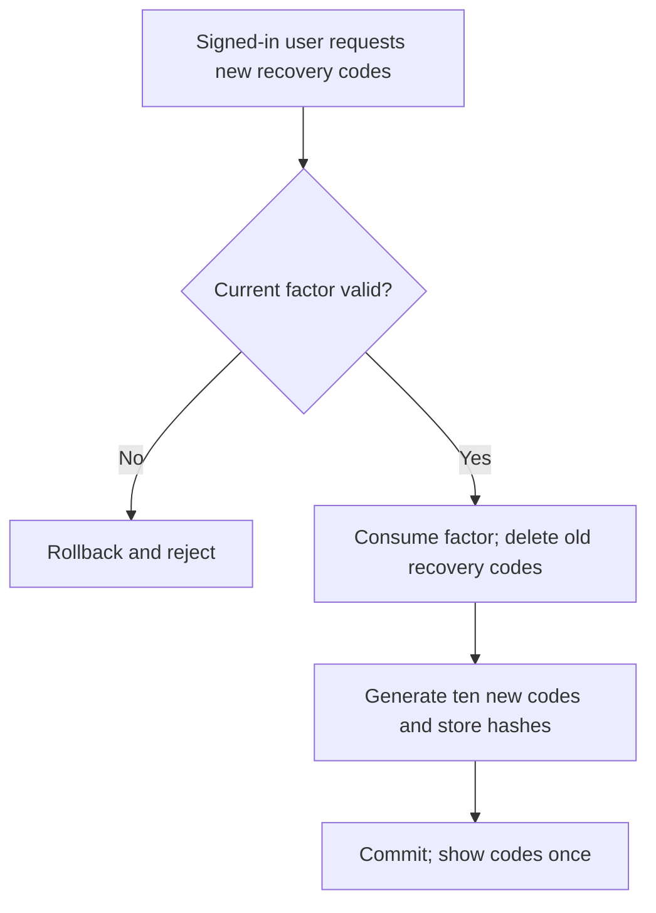

### 3.5 Disabling 2FA

`POST /api/auth/totp/disable` requires a normal authenticated cookie and a valid authenticator/recovery code. It consumes the factor, removes factor and recovery records and commits. Invalid factors roll back.

**Actual behavior:** the current resource does not ask for or verify the local password when disabling 2FA. This differs from an older README description. Explain what the code does, not the stronger policy that could be added later.

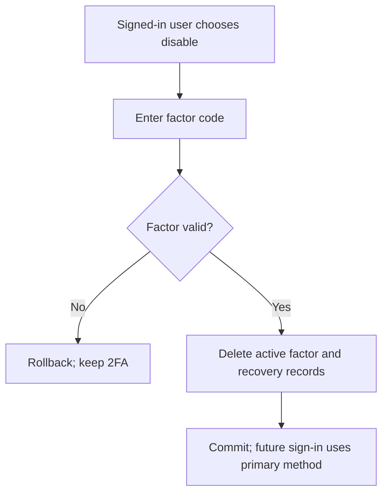

## 4. Password and authenticator recovery

Source: [ForgotPasswordResource](../src/main/java/org/example/auth/ForgotPasswordResource.java). Both recovery purposes use `password_reset_requests` and distinguish `PASSWORD_RESET` from `TOTP_RECOVERY`.

### 4.1 Requesting a password OTP

The visitor enters email and selects `EMAIL` or `SMS` at `POST /api/forgot-password/request`. The **channel named `SMS` currently calls the WhatsApp OTP sender**, not an SMS gateway. Email uses the connected Gmail sender. Do not confuse this with Razorpay's real SMS payment-link notifications.

1. Check nonblank email, supported channel and required OTP signing secret. Email-channel requests also check whether Gmail authorization is available.
2. Find an eligible local-password account with `profile_completed=TRUE` and a saved destination. Unknown/ineligible accounts get a random dummy request ID and the same generic response without sending anything.
3. Expire stale requests; examine an open request and limits. A compatible pending request can be reused as a resend instead of letting repeated form submissions bypass limits.
4. Generate a six-digit OTP with SecureRandom. Store `HMAC-SHA256(requestId + ":" + otp)`, the destination, purpose and expiry, not the plaintext OTP.
5. Commit before dispatching delivery on the two-thread OTP sender executor. The user sees `If an account exists for this email, a verification code has been sent.`

**Why:** recovery must prove control of a saved contact rather than a newly supplied arbitrary destination. The generic response reduces account enumeration. Asynchronous delivery prevents network latency from blocking the main response, but dispatch is not a durable outbox and a process crash can lose a queued send.

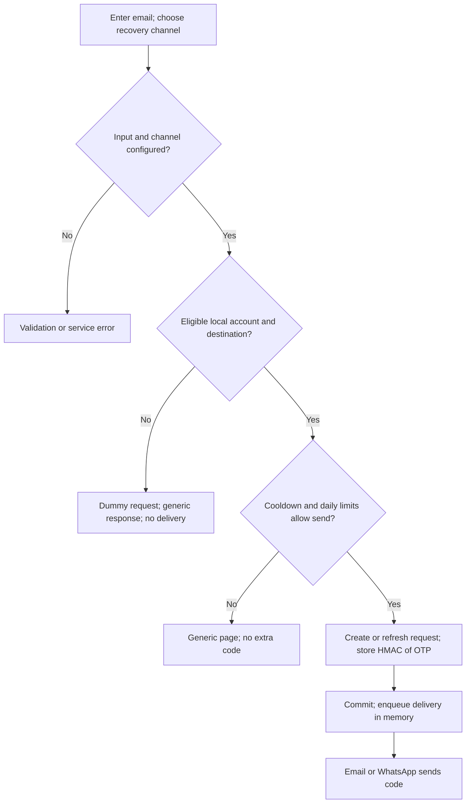

### 4.2 OTP expiry, resend and verification

| Rule | Actual application behavior |
| --- | --- |
| Phone/`SMS` OTP lifetime | Five minutes; delivery implementation is WhatsApp |
| Email OTP lifetime | Ten minutes |
| Resend cooldown | Sixty seconds |
| Daily send budget | Three, counted from requests plus resend counts in the India-time calendar day |
| Overall request resend lifetime | Sixty minutes |
| Verified action/reset-token lifetime | Ten minutes |
| Historical recovery-row cleanup | Ninety-day retention; cleanup is opportunistic and throttled by a ten-minute interval |
| OTP attempt/resend maxima | Read from `max_attempts` and `max_resends` on the request; the insert relies on base-schema defaults, which are not defined in the checked-in base schema |

A resend replaces the OTP hash, refreshes its channel-specific expiry, resets attempt count and increments resend count. The old OTP stops working. A channel/purpose switch can cancel existing open requests. The current `findOpenRequest` query is user-wide, so the resource may cancel an open request for another purpose even though migration V10 permits separate open rows per purpose. Do not claim the service always keeps simultaneous password and authenticator recovery independent.

For verification, lock the request and check purpose, `PENDING`, expiry and remaining attempts. Compare the keyed OTP hash with `MessageDigest.isEqual`. A wrong guess increments attempts and eventually sets `LOCKED`. Correct verification sets `VERIFIED` and returns a random one-time action token; only a purpose-prefixed HMAC of that token is persisted.

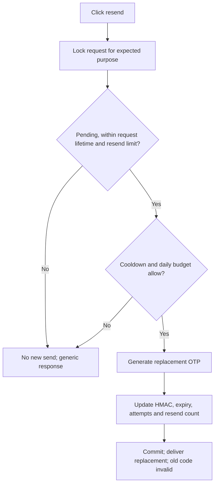

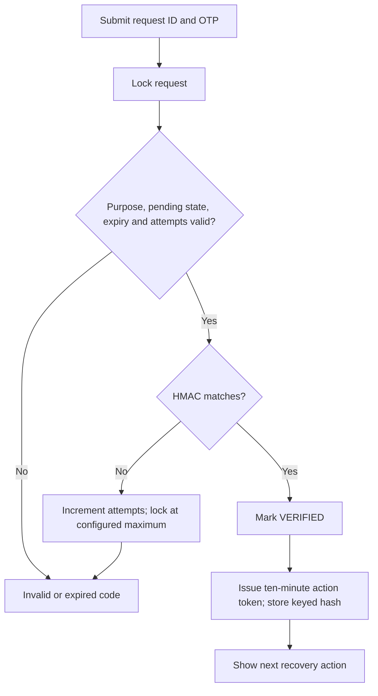

**Example:** an email OTP created at 10:00 expires at 10:10. Verification at or after that expiry fails. A resend after 10:01 can replace it if the budget permits. Correct verification at 10:05 gives a separate action token valid until approximately 10:15; it does not turn the OTP into a permanent authorization.

### 4.3 Setting a new password

`POST /api/forgot-password/reset` accepts the action/reset token, new password and confirmation. Required fields and equality are checked. The code rejects reusing the current password. It locks and checks a matching verified, unexpired `PASSWORD_RESET` request, bcrypt-hashes the new password, updates `local_auth`, marks the request used and cancels other applicable open requests within the transaction. After commit, it schedules a password-changed notice and displays success.

**Why:** proof of contact control authorizes only one password change for a short period. A leaked request ID is not enough; the long random verified token is required. The current code does not introduce password complexity rules or globally revoke existing signed login tokens after resetting a password.

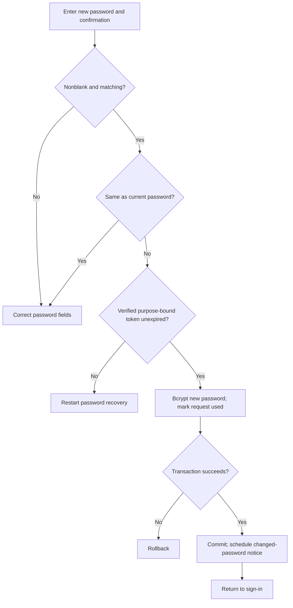

### 4.4 Lost authenticator and recovery codes

The recovery page accepts the account email and saved-contact channel. This path requires an eligible account with active 2FA, uses purpose `TOTP_RECOVERY` and follows the same keyed-OTP, cooldown and attempt protections. Successful OTP verification grants an action token for **authenticator replacement**, not password reset.

The user starts a replacement enrollment using that token. The original factor remains active until a new pending secret is successfully confirmed. Confirmation locks the recovery authorization, removes old login challenges, replaces the active factor, replaces recovery codes, marks the recovery request used and commits. The app then shows new backup codes and asks the user to sign in. An invalid code or expired token rolls back; it does not remove the old factor prematurely.

**Why:** replacement must prove the new authenticator works before removing the old one. **Tradeoff:** saved-email/phone control is a powerful recovery route that can replace the factor; its security depends on that contact and notification provider access.

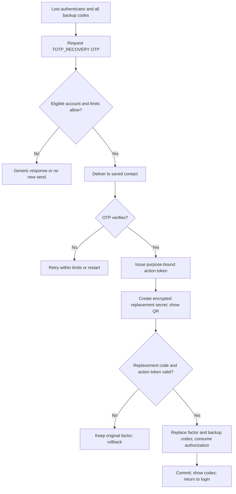

### 4.5 Recovery notices and cleanup

Password changes schedule notices using the existing email/phone notification paths. Notice failure does not roll back an already committed password change. Cleanup deletes sufficiently old recovery rows; expired requests and consumed tokens are rejected through state/expiry checks rather than waiting for cleanup.

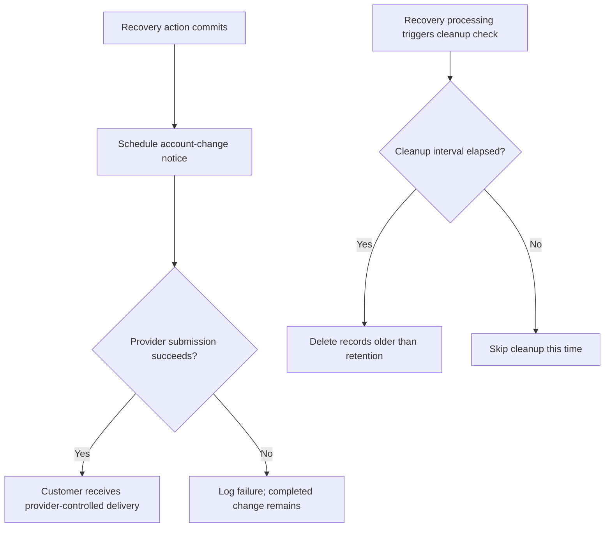

## 5. Administration

Source: [AdminResource](../src/main/java/org/example/admin/AdminResource.java). These actions require `ADMIN`. Forms use IDs for relationships and prepared values for writes. Missing records, invalid IDs, duplicates and foreign-key failures are surfaced as application errors. The resource lists records and provides create/edit operations; it does not implement a general delete endpoint for floors, slots, vehicle types, rates or application users.

### 5.1 List users and change roles

The users view joins user details to roles. Editing a user currently changes the role, not arbitrary profile fields. The update accepts only a role present in `ADMIN`, `USER`, `TICKET_ASSIGNER`; zero updated rows means the person or role was not found. Normal signup supplies new users; this admin action promotes/demotes their permissions.

**Why:** the administrator delegates parking operations without giving every employee business-configuration access. **Tradeoff:** already issued session tokens keep the previous role until expiry/re-login because access checks read signed claims. There is no last-admin/self-demotion safeguard in the role-update query.

```mermaid
flowchart TD
    A[Admin opens users] --> B[List users with role names]
    B --> C[Select edit and role]
    C --> D{User exists and selected role allowed?}
    D -->|No| E[Reject update]
    D -->|Yes| F[Update users.role_id]
    F --> G[Redirect to users list]
```

### 5.2 Create a floor

Enter a floor name and vehicle type. Validate a nonblank name and positive vehicle-type ID, then insert the floor with `status=TRUE`, `created_by` equal to the signed-in admin and the selected type. The vehicle-type relationship distinguishes capacity for different kinds of vehicles.

```mermaid
flowchart TD
    A[Floor create form] --> B[Name and vehicle type]
    B --> C{Required values valid?}
    C -->|No| D[Validation error]
    C -->|Yes| E[Insert active floor with creator]
    E --> F{Write accepted?}
    F -->|No| G[Database constraint error]
    F -->|Yes| H[Floor list]
```

### 5.3 View and edit floors

The list shows floor configuration; edit loads the selected floor and its vehicle type. Save changes the name and vehicle-type relationship. Although the edit query loads `status`, this edit form/action does not provide a general floor-status toggle; operational blocking has separate actions.

**Why:** identifying the floor/type relationship before allocating slots avoids directing a vehicle to the wrong capacity category. Editing a floor's type can affect later pricing queries for existing bookings because those queries join the current floor type; this is a design limitation, not historical configuration snapshotting.

```mermaid
flowchart TD
    A[Admin views floors] --> B[Choose floor edit]
    B --> C{Record exists?}
    C -->|No| D[404 floor not found]
    C -->|Yes| E[Enter name and vehicle type]
    E --> F{Values valid?}
    F -->|No| G[Reject]
    F -->|Yes| H[Update selected floor]
    H --> I[Return to list]
```

### 5.4 Create a slot

Enter slot name and floor. The new slot is `AVAILABLE` and records its creator. The floor relationship makes allocation aware of location, vehicle type and floor-wide blocks.

```mermaid
flowchart TD
    A[Slot create form] --> B[Slot name and floor]
    B --> C{Nonblank name and valid ID?}
    C -->|No| D[Reject input]
    C -->|Yes| E[Insert AVAILABLE slot]
    E --> F{Write accepted?}
    F -->|No| G[Constraint error]
    F -->|Yes| H[Slot list]
```

### 5.5 View and edit slots

The view joins slot/floor information. Edit changes slot name and floor; it does not directly overwrite occupancy. Occupancy changes in booking/checkout. Moving an occupied slot to another floor can change the current joined context of historical/active bookings; the edit path does not comprehensively freeze historical location or pricing.

```mermaid
flowchart TD
    A[Admin lists slots] --> B[Select slot]
    B --> C{Slot found?}
    C -->|No| D[Not found]
    C -->|Yes| E[Edit name and floor]
    E --> F{Required values valid?}
    F -->|No| G[Reject]
    F -->|Yes| H[Update name/floor; retain occupancy state]
    H --> I[Slot list]
```

### 5.6 Create a vehicle type

The administrator supplies a nonblank type name. Insert into `vehicle_type` and redirect to the list; database uniqueness or other constraints can reject it. Vehicle types are configuration shared by floors and pricing, not a free-text type invented independently on every booking.

```mermaid
flowchart TD
    A[Create vehicle type] --> B{Type name nonblank?}
    B -->|No| C[Reject]
    B -->|Yes| D[Insert vehicle_type]
    D --> E{Accepted?}
    E -->|No| F[Constraint error]
    E -->|Yes| G[Type list]
```

### 5.7 View and edit vehicle types

Load the selected type, reject a missing ID, require a name and update it. Existing floor/rate relationships refer to the ID, so renaming does not require rewriting every related booking.

```mermaid
flowchart TD
    A[View vehicle types] --> B[Choose edit]
    B --> C{Type found?}
    C -->|No| D[Not found]
    C -->|Yes| E[Submit new name]
    E --> F{Nonblank?}
    F -->|No| G[Reject]
    F -->|Yes| H[Update type name; return to list]
```

### 5.8 Create a pricing tier

Enter vehicle type, positive duration limit in minutes and nonnegative `BigDecimal` rate per minute. Insert into `vehicle_rate`. A zero rate is accepted; a missing, negative or invalid input fails. Duration limits define cumulative boundaries, not standalone fixed fees.

**Why:** tiered rates allow the first interval to have a different minute price than longer stays. The admin does not manually type each checkout bill; the server evaluates configured tiers.

```mermaid
flowchart TD
    A[Create vehicle rate] --> B[Type, duration limit and minute rate]
    B --> C{Positive IDs/limit and nonnegative rate?}
    C -->|No| D[Reject]
    C -->|Yes| E[Insert vehicle_rate]
    E --> F{Constraints accept?}
    F -->|No| G[Show write error]
    F -->|Yes| H[Rate list]
```

### 5.9 View and edit pricing tiers

Load the selected tier, display current type/limit/rate, apply the same validation and update the record. The checkout calculates from current configuration; changing a rate affects new calculations. An already created online payment request stores a frozen amount rather than recalculating while the customer pays.

```mermaid
flowchart TD
    A[View rates] --> B[Choose edit]
    B --> C{Rate exists?}
    C -->|No| D[Not found]
    C -->|Yes| E[Submit type, boundary and rate]
    E --> F{Valid?}
    F -->|No| G[Reject]
    F -->|Yes| H[Update selected tier]
    H --> I[Rate list]
```

### 5.10 Block a floor

Enter a floor and reason. An `INSERT ... SELECT` creates `floor_block` with admin, start time and reason only if the floor exists and has no current open block. Open means `date_end IS NULL`; duplicate/missing selection can result in zero inserted rows and a conflict. Booking allocation excludes blocked floors.

**Why:** temporarily unavailable capacity should stay in configuration with an auditable reason rather than being deleted. Blocking does not evict existing parked vehicles or automatically complete their bookings.

```mermaid
flowchart TD
    A[Choose floor and reason] --> B{Required values valid?}
    B -->|No| C[Reject]
    B -->|Yes| D{Floor exists with no current block?}
    D -->|No| E[Conflict]
    D -->|Yes| F[Insert open floor block]
    F --> G[New allocations exclude floor]
```

### 5.11 Block a slot

Enter slot and reason. The insert requires an existing slot, no current slot block and no current parent-floor block. It records who blocked it and when. The allocation query checks block records in addition to occupancy; a block is not the same as `OCCUPIED`.

```mermaid
flowchart TD
    A[Choose slot and reason] --> B{Input valid?}
    B -->|No| C[Reject]
    B -->|Yes| D{Slot exists and slot/floor not currently blocked?}
    D -->|No| E[Conflict]
    D -->|Yes| F[Insert open slot block]
    F --> G[Allocation excludes slot]
```

### 5.12 Unblock a floor

The unblock endpoint calls `finishBlock` with a server-selected table name. It sets `date_end=CURRENT_TIMESTAMP` on an open block, rather than deleting its history. Invalid ID or an already closed/missing block is rejected. Eligibility for new bookings still depends on floor status, available slots and any individual slot blocks.

```mermaid
flowchart TD
    A[Unblock selected floor block] --> B{Positive block ID?}
    B -->|No| C[Reject]
    B -->|Yes| D[Close open floor block by end time]
    D --> E{One record changed?}
    E -->|No| F[Active block not found]
    E -->|Yes| G[Return to current blocks]
```

### 5.13 Unblock a slot

The same close-record mechanism applies to `slot_block`. Removing an individual block does not override an occupied slot or a blocked parent floor.

```mermaid
flowchart TD
    A[Unblock selected slot block] --> B[Update date_end on open slot block]
    B --> C{Record changed?}
    C -->|No| D[Not found or already closed]
    C -->|Yes| E[Keep history; reevaluate normal allocation eligibility]
```

### 5.14 Current floor blocks and floor-block history

The current view selects open floor blocks; history exposes records including closed periods. Related floor/user information makes the reason and responsible person understandable. Neither list mutates parking state.

```mermaid
flowchart TD
    A[Open current floor blocks] --> B[Query open floor-block records]
    B --> C[Render floor, reason and responsible user]
    C --> D[Optional unblock action]
```

```mermaid
flowchart TD
    A[Open floor-block history] --> B[Read block records and related details]
    B --> C[Show start/end periods and reasons]
    C --> D[Audit past restrictions without changing records]
```

### 5.15 Current slot blocks and slot-block history

These parallel views operate on individual slots and preserve their floor context. Current records support operational decisions; historical records explain why a slot was unavailable in an earlier period.

```mermaid
flowchart TD
    A[Open current slot blocks] --> B[Read open slot blocks and locations]
    B --> C[Show reasons and unblock options]
```

```mermaid
flowchart TD
    A[Open slot-block history] --> B[Read past/current block periods]
    B --> C[Display slot, floor, reason and dates]
```

## 6. Parking and checkout

Source: [BookingResource](../src/main/java/org/example/booking/BookingResource.java). Shared reporting requires `ADMIN` or `TICKET_ASSIGNER`; entry creation and checkout actions explicitly require `TICKET_ASSIGNER`.

### 6.1 Vehicle entry and slot allocation

The assigner enters vehicle type, vehicle number, saved customer phone and color. The server requires all four, normalizes the vehicle number and trims contact/color. The form and handler are not identical: color may appear optional in markup but the server rejects it when blank. Booking creation does not itself use the same explicit ten-digit server validation as signup/payment messages.

Within a transaction:

1. Check whether that vehicle has an active booking: a `booking` with no `duration_amount`.
2. Find the first eligible slot ordered by floor ID and slot ID, matching vehicle type, active floor, `AVAILABLE` state and no open floor/slot block.
3. Lock the candidate slot with `FOR UPDATE OF s` to serialize allocation of that row.
4. Look up `vehicle_details` by vehicle number and phone. Reuse its color, update a changed color or insert new details.
5. Insert the booking with start time and set the slot to `OCCUPIED`.
6. Commit; call the booking WhatsApp notification; show vehicle, color, floor and slot to direct the customer.

No eligible capacity or an already active vehicle produces a conflict. Insert failures roll back both booking and slot update. SQL duplicate-key failures receive a conflict response.

**Why:** capacity checks are on the server, not trusted from a displayed count. Booking and occupancy change together. **Concurrency limit:** row locking protects a selected slot, while the separate active-vehicle query is not itself a unique-vehicle lock. Full simultaneous duplicate-vehicle prevention depends on relevant base-schema constraints; the base schema is not fully included in the repository. Do not claim this precheck alone guarantees it under every race.

```mermaid
flowchart TD
    A[Assigner enters vehicle data] --> B{Required input valid?}
    B -->|No| C[Validation error]
    B -->|Yes| D[Begin transaction; check active vehicle]
    D --> E{Already parked?}
    E -->|Yes| F[Rollback; conflict]
    E -->|No| G[Select and lock eligible available slot]
    G --> H{Slot found?}
    H -->|No| F
    H -->|Yes| I[Reuse or update vehicle details]
    I --> J[Insert booking; mark slot OCCUPIED]
    J --> K{Writes succeed?}
    K -->|No| L[Rollback]
    K -->|Yes| M[Commit; send booking WhatsApp]
    M --> N[Show allocated floor and slot]
```

### 6.2 Checkout search and charge preview

The assigner searches by vehicle number. The query joins the active booking, floor/slot/type and vehicle details. Missing or already closed bookings cannot proceed. The server calculates elapsed billable minutes and rate-derived amount, displays them and offers `CASH` or `ONLINE`.

Checkout generates a random CSRF value in a hidden form field and a secure HttpOnly cookie. The pay action requires equality before either payment path. The preview is not a browser-authoritative amount: payment actions calculate/store the server-side amount.

```mermaid
flowchart TD
    A[Search checkout by vehicle number] --> B[Normalize and query active booking]
    B --> C{Active booking found?}
    C -->|No| D[No active checkout]
    C -->|Yes| E[Calculate minutes and tiered amount]
    E --> F[Display charge and CASH/ONLINE choice]
    F --> G[Generate CSRF form value and cookie]
    G --> H[Assigner clicks Pay]
    H --> I{CSRF matches?}
    I -->|No| J[Reject submission]
    I -->|Yes| K[Selected payment path]
```

### 6.3 Duration and pricing calculation

Billable minutes use `CEIL(GREATEST(elapsed_seconds / 60, 1))`: any positive fractional minute rounds up and at least one minute is charged. The displayed duration/charge can change before a cash payment or a new online request is created. An online request freezes its cutoff, minutes and amount.

`calculateAmount` loads `vehicle_rate` ordered by `duration_limit`. For each cumulative boundary, charge only the minutes in that segment. After the final boundary, remaining minutes use the final tier's rate. Missing rate configuration fails the calculation rather than silently charging zero. Rates and amounts use `BigDecimal`; the current algorithm does not enforce a whole-rupee rounding policy.

**Worked example, illustrative rates:** first 60 minutes at INR 1.00/minute; the next segment through minute 120 at INR 0.50/minute. A 90-minute stay costs `60 × 1.00 + 30 × 0.50 = INR 75.00`. A 150-minute stay costs `60 + 60 × 0.50 + 30 × 0.50 = INR 105.00`. The duration boundary is cumulative, so the second segment is 60 minutes, not an additional 120 minutes.

For Razorpay, INR 34.00 converts exactly to 3400 paise using decimal-point movement and `longValueExact`. More precision than integral paise is rejected by exact conversion instead of being silently rounded. Whole-rupee examples do not imply Java floating-point money calculations.

```mermaid
flowchart TD
    A[Start time and server cutoff] --> B[Round elapsed minutes up; minimum one]
    B --> C[Load tiers sorted by cumulative boundary]
    C --> D{Any rate configured?}
    D -->|No| E[Calculation error]
    D -->|Yes| F[Multiply segment minutes by BigDecimal rate]
    F --> G{More configured segments and minutes?}
    G -->|Yes| F
    G -->|No| H[Charge overflow at last tier rate]
    H --> I[Return exact decimal amount]
```

### 6.4 Cash checkout

After CSRF and method validation, lock the active booking. If an online request is `CREATING`, `PENDING` or `REVIEW`, refuse cash until it is reconciled. Otherwise calculate minutes and amount at the server cutoff, insert `duration_amount` and a `payment` with method `CASH`, `SUCCESS` and the assigner's ID, then release the slot as `AVAILABLE` in the same transaction.

Commit before sending the checkout WhatsApp message. A repeated checkout no longer finds an active booking. Failed database work rolls back; a notification failure is not evidence that cash checkout failed.

**Why:** collecting cash while Razorpay might have charged the customer creates duplicate-payment risk. Closing the booking, recording money and releasing capacity must form one consistent operation.

```mermaid
flowchart TD
    A[Choose CASH and submit] --> B[Check CSRF; lock active booking]
    B --> C{Booking active?}
    C -->|No| D[Conflict]
    C -->|Yes| E{Unresolved online request?}
    E -->|Yes| F[Reconcile before cash]
    E -->|No| G[Calculate current amount and duration]
    G --> H[Insert duration and cash SUCCESS payment]
    H --> I[Release slot]
    I --> J{Transaction succeeds?}
    J -->|No| K[Rollback]
    J -->|Yes| L[Commit; checkout WhatsApp; bookings view]
```

### 6.5 Current bookings

`/api/booking/current` shows bookings with no `duration_amount`, including phone, start time and location. Pending online payment remains an active booking because only verified successful checkout creates duration closure.

```mermaid
flowchart TD
    A[Open current bookings] --> B[Select bookings without duration closure]
    B --> C[Join floor and slot]
    C --> D[Display active parking]
```

### 6.6 All booking history

`/api/booking/bookings` left-joins checkout data and displays `ACTIVE` when no end time exists, otherwise `COMPLETED`. This is a parking-state view, not a replacement for the provider attempt/reconciliation history.

```mermaid
flowchart TD
    A[Open bookings] --> B[Read bookings with optional checkout data]
    B --> C{End time recorded?}
    C -->|No| D[Display ACTIVE]
    C -->|Yes| E[Display COMPLETED]
```

### 6.7 Payment history

`/api/booking/payment-history` joins finalized payments to booking/location and amounts. It prefers `gateway_method` when present and falls back to the cash/legacy `payment_method`. Failed provider attempts are tracked separately; they are not fake successful entries in this page.

```mermaid
flowchart TD
    A[Open payment history] --> B[Read finalized payment records]
    B --> C[Join amount, vehicle and location]
    C --> D[Prefer gateway method; otherwise legacy method]
    D --> E[Show status and verifying assigner ID]
```

### 6.8 Duration history

`/api/booking/duration` left-joins duration records, so active entries can have no end time/duration/amount yet. Closed entries show the saved figures. Online checkout uses its pricing cutoff as the saved end time, not necessarily the later notification/webhook arrival time.

```mermaid
flowchart TD
    A[Open duration view] --> B[Join bookings with optional duration_amount]
    B --> C[Display start, saved end, duration and charge]
    C --> D[Missing closure values identify still-active entries]
```

## 7. Razorpay payments

Sources: [RazorpaySetupResource](../src/main/java/org/example/admin/RazorpaySetupResource.java), [PaymentService](../src/main/java/org/example/payment/PaymentService.java), [PaymentLinkService](../src/main/java/org/example/payment/PaymentLinkService.java), [RazorpayPaymentResource](../src/main/java/org/example/payment/RazorpayPaymentResource.java), [MerchantConfig](../src/main/java/org/example/payment/MerchantConfig.java) and [PaymentNotificationListener](../src/main/java/org/example/listener/PaymentNotificationListener.java).

### 7.1 Merchant OAuth connection

An admin opens Razorpay Setup, obtains the setup CSRF field/cookie and chooses Connect. The server validates CSRF, generates a random state, stores its SHA-256 hash with admin, mode and expiry, and sends the merchant to Razorpay requesting `read_write`. Callback checks the initiating browser state, current admin and stored unused/unexpired state, exchanges the code and saves encrypted merchant credentials in a new configuration version.

**Why:** the parking business collects into its own connected account. Versioned configuration preserves the credentials associated with earlier pending payments when a new connection is saved. This supports one configured merchant per database, not arbitrary tenant routing inside one shared schema.

```mermaid
flowchart TD
    A[Admin chooses Razorpay Connect] --> B{Setup CSRF valid?}
    B -->|No| C[Reject]
    B -->|Yes| D[Store hashed expiring state and admin]
    D --> E[Merchant authorizes Razorpay access]
    E --> F{Callback state, browser and admin match?}
    F -->|No| C
    F -->|Yes| G[Consume state and exchange code]
    G --> H[Encrypt and version merchant configuration]
    H --> I[Show connected account and webhook URL]
```

### 7.2 Merchant API-key fallback

The current setup page still has an API-key fallback with Key ID and Key Secret fields. It checks CSRF, credential format/mode and tests API access before saving encrypted credentials. The webhook signing secret is read from the encrypted `RAZORPAY_WEBHOOK_SECRET` entry in `app_settings`, not a vendor-entered webhook-secret field. The startup listener creates the setting if absent, and the admin-only Razorpay Setup page displays it for configuring Razorpay webhooks.

**Why:** this provides a learning/test integration while partner OAuth approval is pending. It is a fallback configuration path, not a way to bypass a merchant's provider permissions or live account requirements.

```mermaid
flowchart TD
    A[Admin submits merchant key pair] --> B{CSRF and mode/format valid?}
    B -->|No| C[Reject]
    B -->|Yes| D[Test Razorpay API authorization]
    D --> E{Provider accepts?}
    E -->|No| F[Show provider rejection]
    E -->|Yes| G[Encrypt secret; save new config version]
```

### 7.3 Merchant credential refresh and revocation

`MerchantConfig.load` decrypts the configuration. OAuth access credentials within five minutes of expiry are refreshed with the saved refresh token; refreshed access/public/refresh values and expiry are saved. API-key mode uses Basic authorization; OAuth mode uses Bearer authorization. A signed `account.app.authorization_revoked` event disables the matched configuration for new starts. Signature validation must remain possible even when an OAuth access token is expired/revoked, so the webhook authentication path does not depend on refreshing that token first.

```mermaid
flowchart TD
    A[Load merchant configuration] --> B{OAuth and expiry approaching?}
    B -->|No| C[Use saved authorized credentials]
    B -->|Yes| D[Exchange refresh token]
    D --> E{Refresh accepted?}
    E -->|No| F[Payment operation unavailable]
    E -->|Yes| G[Encrypt and save rotated token data]
    G --> C
    H[Signed authorization-revoked event] --> I[Deactivate matched merchant config]
```

### 7.4 Create and freeze a payment request

Choosing ONLINE runs `PaymentService.start`. The server locks the booking, verifies it is active and examines unresolved requests. A live pending request is reused; creating/review requests block new collection; expired native links require reconciliation before retry.

The code freezes amount, duration and pricing cutoff, takes a phone snapshot and saves a UUID request with `CREATING` **before** making the external create call. It posts to `https://api.razorpay.com/v1/payment_links` with:

| Field | Current value and reason |
| --- | --- |
| `amount`, `currency` | Exact server-calculated integer paise and `INR`; no browser-controlled money |
| `reference_id` | Request UUID; supports recovery of uncertain creation |
| `description` | Parking booking number |
| `customer.contact` | Saved ten-digit number with `+91` |
| `accept_partial` | `false`; partial collection must not close a full-price checkout |
| `notify` | `sms=true`, `email=false`; **initial SMS is requested during provider link creation** |
| `reminder_enable` | `false` |
| `expire_by` | Fifteen minutes plus a thirty-second transit allowance from creation-call preparation |
| `callback_url`, `callback_method` | Request-specific callback and `get` |
| Notes/email | Omitted |

The create response must match reference, amount, currency and full-payment setting. The application saves native link ID, URL, provider expiry and order if available, changes `CREATING` to `PENDING`, and queues WhatsApp link messaging. Initial SMS is not also queued, avoiding duplicate initial notifications. The returned expiry becomes the authoritative saved deadline.

**Why save before the HTTP call?** a timeout does not mean Razorpay failed to create the link. The UUID lets reconciliation look up the original instead of blindly creating a second one. Definitive 400/401/403/422 rejection closes the unpaid request as expired; ambiguous errors leave creation unresolved. Error descriptions are surfaced with bounded/redacted content rather than suggesting every failure is account activation.

```mermaid
flowchart TD
    A[Assigner chooses ONLINE] --> B[Lock active booking]
    B --> C{Existing unresolved request?}
    C -->|Live pending| D[Reuse request/link]
    C -->|Creating or review| E[Require reconciliation]
    C -->|None| F[Calculate and freeze charge and duration]
    F --> G[Save CREATING request and phone snapshot]
    G --> H[POST native payment link; request initial SMS]
    H --> I{Valid matching response?}
    I -->|Yes| J[Save link/deadline; PENDING; queue WhatsApp]
    I -->|Definitive rejection| K[Mark unpaid request EXPIRED]
    I -->|Ambiguous timeout/error| L[Keep CREATING; recover by reference]
    J --> M[Customer opens link or assigner opens payment page]
```

### 7.5 Customer payment and signed callback

The assigner page displays the frozen amount, native link and deadline. A customer can use the link from SMS/WhatsApp without logging into the parking app. Payment-method selection and payment credential entry happen on Razorpay's hosted page.

The native callback validates the saved link/reference and HMAC signature over `link_id|reference_id|status|payment_id`, then obtains/reconciles provider details. A redirect, link click or a `paid` string from an unverified browser is never sufficient to release the slot. Status endpoints reconcile and show saved status; a page receiving a generic browser-close/client-error signal can only report uncertain status.

```mermaid
flowchart TD
    A[Customer receives native link] --> B[Open Razorpay hosted page]
    B --> C[Select method and authorize payment]
    C --> D[Provider redirects to callback]
    D --> E{Saved IDs and callback signature valid?}
    E -->|No| F[Reject callback]
    E -->|Yes| G[Fetch/reconcile provider payment]
    G --> H[Run captured-payment decision]
    H --> I[Display verified status]
```

### 7.6 Webhook authentication and handling

`POST /api/payments/razorpay/webhook/{configId}` receives raw bytes. The handler rejects oversized payloads above 262144 bytes, unknown configurations and invalid `X-Razorpay-Signature`. HMAC is computed over raw bytes, **not** parsed/reformatted JSON. A configured account ID must match the signed event.

The payment webhook handles `payment_link.paid`, `payment_link.expired`, `payment_link.cancelled`, and `payment.failed`. The first three validate the native link/reference; `payment.failed` matches the payment to the saved request through its order or link ID, verifies the order/link association and amount/currency, then records the failed attempt and queues configured customer messages. Successful-payment processing stores/deduplicates event identifiers; absent event IDs get a content-derived hash fallback. Other event types may be acknowledged but are not processed here.

Webhook provider authentication differs from user login: it is a public endpoint because Razorpay does not possess a user's session, but it requires the signing secret. Processing errors return a retryable response. Do not claim every acknowledged nonpayment event is written to the payment-event audit table.

```mermaid
flowchart TD
    A[Razorpay posts raw webhook] --> B{Size and config valid?}
    B -->|No| C[Reject]
    B -->|Yes| D{Raw-body HMAC valid?}
    D -->|No| C
    D -->|Yes| E{Merchant account matches?}
    E -->|No| F[Acknowledge and ignore]
    E -->|Yes| G{Event family}
    G -->|Revocation| H[Disable config]
    G -->|Native link event| I[Validate link/reference; bind order]
    G -->|Known payment/order| J[Process authenticated payment]
    G -->|Unknown order| K[Acknowledge; background reconciliation]
    G -->|Unsupported| F
    I --> J
    J --> L[Commit decision; acknowledge]
    J -->|Processing error| M[503 retryable response]
```

### 7.7 When payment is allowed to close parking

The captured-payment decision requires all of these:

1. Provider status is `captured` and provider `captured` flag is true.
2. Order matches the saved request; amount matches exactly; currency is INR.
3. `amount_refunded` is zero.
4. Provider payment creation time is at/after the pricing cutoff and strictly before the saved expiry. Provider timestamps have second precision.
5. The booking has not already closed, and this request is not already paid.

The service locks booking and request, recognizes already recorded success, upserts `payment_attempt`, and if accepted inserts frozen `duration_amount`, inserts finalized `payment`, releases the slot, sets request `PAID` and enqueues the success notification in **one transaction**. The gateway's actual method is stored in `gateway_method`; the legacy `payment_method` is null for online success.

**Why:** payment state, parking closure and capacity cannot contradict each other. Duplicate callbacks/webhooks must not insert a second checkout. A payment started before expiry can be captured/notified later because validation uses provider payment creation time, not webhook-arrival time. A captured but mismatched, refunded, out-of-window or extra payment goes to `REVIEW`, not automatic closure. Refund resolution is not automated.

```mermaid
flowchart TD
    A[Authenticated provider payment] --> B[Lock booking and request]
    B --> C{Same successful payment already recorded?}
    C -->|Yes| D[Return existing completion]
    C -->|No| E{Captured status and flag?}
    E -->|No| F[Track FAILED or PENDING attempt]
    E -->|Yes| G{Order, amount, currency, refund and window valid?}
    G -->|No| H[Track REVIEW; no slot release]
    G -->|Yes| I{Booking/request already closed?}
    I -->|Yes| H
    I -->|No| J[Insert duration and successful payment]
    J --> K[Release slot; set PAID; queue success]
    K --> L[Commit all changes]
```

```mermaid
stateDiagram-v2
    [*] --> CREATING: Persist request
    CREATING --> PENDING: Native link recovered or stored
    CREATING --> EXPIRED: Definitive creation rejection
    PENDING --> PENDING: Failed attempt or still processing
    PENDING --> PAID: Verified matching captured payment
    PENDING --> EXPIRED: Reconciled unpaid expiry or cancellation
    PENDING --> REVIEW: Captured payment requires investigation
    EXPIRED --> PAID: Delayed valid in-window captured payment
    EXPIRED --> REVIEW: Captured payment fails checkout checks
```

`FAILED` is an attempt/result disposition, not a persisted request status in this state model. A customer may retry a failed attempt while the same `PENDING` link is still valid. `REVIEW` can require administrator/provider investigation; the admin page is reconciliation, not a generic refund approval workflow.

### 7.8 Failure, uncertainty and resending links

Confirmed `failed` attempts produce a WhatsApp failure message. Provider error code/reason classify network/timeout and server failures. If the original link is still live, queue a Razorpay SMS resend and include that same URL/deadline in the WhatsApp error message. A unique request/event/channel key prevents repeatedly enqueueing the same failure event.

The SMS resend API is `POST /v1/payment_links/{id}/notify_by/sms`. Razorpay SMS sends a link, not custom application error prose. The error/status explanation therefore goes through WhatsApp. Resends do not extend expiry. At send time, paid/review/expired states suppress inappropriate queued links; an expired failure message asks staff for a fresh link instead.

An application HTTP timeout or browser error is **uncertain**, not provider-confirmed failed payment. Its message tells the customer to check status or wait for staff before paying again. Closing Razorpay's external hosted page is not directly observable by this app; do not promise an immediate custom close notification for every external-page action.

```mermaid
flowchart TD
    A[Payment error observed] --> B{Provider confirmed failed attempt?}
    B -->|No| C[Send unconfirmed-status warning; reconcile]
    B -->|Yes| D[Classify failure and record attempt]
    D --> E{Same link still PENDING and unexpired?}
    E -->|Yes| F[Queue SMS resend and WhatsApp failure with link]
    E -->|No| G[WhatsApp asks staff to check and issue fresh link]
    F --> H[Keep original deadline]
    C --> I[Do not blindly request another payment]
```

### 7.9 Background and manual reconciliation

The payment worker dispatches every two seconds, sending up to ten due messages before taking one due `CREATING`/`PENDING` request. It leases reconciliation work and normally schedules that request again about thirty seconds later, subject to backlog/provider latency. Native link recovery searches by UUID reference rather than recreating uncertain links. It binds orders and processes available payments. Expired authorized/captured cases are checked before treating a request as safely unpaid.

An admin can open `/api/admin/payment-reconciliation` and submit the selected request with CSRF validation. It invokes the same reconciliation logic. Reconciliation does not mean trusting the admin button as proof that money was collected.

```mermaid
flowchart TD
    A[Worker selects due request] --> B{Native link ID known?}
    B -->|No| C[Find original link by reference]
    B -->|Yes| D[Fetch native link and payment details]
    C --> D
    D --> E{Payment disposition}
    E -->|Captured and valid| F[Atomic checkout completion]
    E -->|Unpaid and expiry resolved| G[Mark EXPIRED; allow later retry/cash]
    E -->|Uncertain| H[Keep unresolved; schedule next check]
    E -->|Mismatch or extra payment| I[REVIEW]
```

```mermaid
flowchart TD
    A[Admin opens reconciliation list] --> B[Select request; submit CSRF-protected action]
    B --> C{Authorized and CSRF valid?}
    C -->|No| D[Reject]
    C -->|Yes| E[Fetch and reconcile provider state]
    E --> F[Show actual resulting status or error]
```

### 7.10 Notification outbox and checkout success template

Payment messages live in `payment_message_outbox`. Workers claim rows using locks and a one-minute lease before calling providers outside the transaction. Accepted submissions become `SUBMITTED`; transient submission errors return to `READY` with increasing delay, with up to five attempts. Stale messages are skipped. A crash after provider acceptance but before status update can duplicate delivery; the design is not exactly-once messaging.

Success uses `CHECKOUT_CONFIRMATION` with committed vehicle/name, slot, duration and amount. Links and unsuccessful/pending status use the existing booking template with text appended. `SUBMITTED` means accepted by the provider, not verified arrival on the phone.

```mermaid
flowchart TD
    A[Committed payment event queues unique message] --> B[Worker locks and leases due row]
    B --> C{Still relevant and attempts available?}
    C -->|No| D[SKIPPED or FAILED]
    C -->|Yes| E[Commit lease; call provider]
    E --> F{SUCCESS WhatsApp event?}
    F -->|Yes| G[Use checkout template and saved bill]
    F -->|No| H[Send link/status or SMS resend]
    G --> I{Provider accepts?}
    H --> I
    I -->|Yes| J[SUBMITTED]
    I -->|No| K[Retry READY or terminal FAILED]
```

### 7.11 Legacy customer capability links

Older application-hosted customer routes remain. A long random URL token grants access to only that request; the database stores its SHA-256 hash. Invalid/missing tokens are rejected. Legacy checkout signature verification checks `order_id|payment_id` using the relevant merchant signature secret and fetches provider payment details before completing. These endpoints support existing requests; new checkout creates native Razorpay links.

```mermaid
flowchart TD
    A[Open legacy customer URL with token] --> B[Hash token and compare saved capability]
    B --> C{Authorized for this request?}
    C -->|No| D[Reject access]
    C -->|Yes| E[Legacy checkout/status action]
    E --> F{Submitting payment proof?}
    F -->|Yes| G[Verify merchant HMAC; fetch payment]
    G --> H[Same captured-payment completion rules]
    F -->|No| I[Display permitted request status]
```

### 7.12 Receipts and a complete payment example

Razorpay receipt settings are provider-controlled and separate from this application's checkout confirmation. The standard-link request contains no undocumented receipt flag. Enabling receipts during dashboard link creation does not prove every API-created link gets a receipt; email is omitted, so do not claim application-provided email receipts. The app's verified checkout WhatsApp confirmation remains independent.

**Example:** booking 42 freezes INR 34.00 and 34 minutes at its cutoff. The saved provider deadline is approximately fifteen minutes plus transit allowance later. Initial Razorpay SMS and queued WhatsApp carry the same native link. A captured INR payment for 3400 paise, correct order and created inside that window closes booking 42. A later repeated webhook detects already completed success. A different extra captured payment is recorded for review; it does not create another duration record or release a second slot. If the first attempt is provider-confirmed failed, the original pending link can be resent without repricing or extending its window.

This sequence shows one successful path. Webhooks, customer callbacks and background reconciliation can arrive in a different order; they converge on the same payment validation and transaction rules.

```mermaid
sequenceDiagram
    actor Assigner
    participant App as Parking application
    participant DB as Business records
    participant RP as Razorpay
    actor Customer
    participant WA as WhatsApp
    Assigner->>App: Choose ONLINE and submit checkout
    App->>DB: Lock booking and save frozen CREATING request
    App->>RP: Create native payment link with SMS enabled
    RP-->>App: Link ID, URL and expiry
    App->>DB: Save PENDING link and WhatsApp outbox event
    RP-->>Customer: Initial SMS with payment link
    App->>WA: Worker submits booking-template link message
    WA-->>Customer: Payment link message
    Customer->>RP: Open hosted page and pay
    RP-->>App: Signed payment webhook
    App->>App: Verify signature and captured-payment conditions
    App->>DB: Atomic checkout, successful payment, slot release and outbox
    App-->>RP: Acknowledge processed event
    App->>WA: Worker submits checkout-template confirmation
    WA-->>Customer: Checkout confirmation
    RP-->>App: Possible repeated webhook
    App->>DB: Recognize recorded successful payment
    App-->>RP: Acknowledge without duplicate checkout
```

## 8. Google configuration and Gmail

Sources: [GoogleOAuthConfig](../src/main/java/org/example/notification/GoogleOAuthConfig.java), [EmailSetupResource](../src/main/java/org/example/admin/EmailSetupResource.java), [GmailEmailService](../src/main/java/org/example/notification/GmailEmailService.java), [GmailAutoReplyService](../src/main/java/org/example/notification/GmailAutoReplyService.java) and [GmailAutoReplyListener](../src/main/java/org/example/listener/GmailAutoReplyListener.java).

### 8.1 Configure the business's Google client

An admin enters a Google OAuth web client ID and secret in Email Setup. The client ID must match the accepted Google-client format and the secret must be nonblank and within the size bound. `GoogleOAuthConfig.save` encrypts the secret and saves one configuration at `config_id=1`. The same per-database client supports Google login and Gmail authorization.

If the actual client ID/secret changes, the transaction deletes the saved Gmail sender because its grants belong to the previous client. Saving the same credentials does not deliberately disconnect it. The client secret is not returned to the page as a displayed decrypted value.

**Why:** a business can manage its Google client through authorized configuration without exposing secrets to ordinary users. Changing ownership must not silently reuse another OAuth client's saved grant.

```mermaid
flowchart TD
    A[Admin submits Google client ID and secret] --> B{Format and required fields valid?}
    B -->|No| C[Reject input]
    B -->|Yes| D[Read current encrypted client]
    D --> E[Encrypt and save new credentials]
    E --> F{Actual credentials changed?}
    F -->|Yes| G[Remove saved Gmail sender authorization]
    F -->|No| H[Retain saved sender]
    G --> I[Commit; reconnect Gmail]
    H --> J[Commit configuration]
```

### 8.2 Authorize a Gmail sender

The admin selects Connect Gmail. The application creates a ten-minute signed state carrying setup purpose and admin ID, places the same state in a secure HttpOnly cookie and redirects to Google. Requested scopes include `openid`, `email`, `gmail.send` and `gmail.metadata`. `access_type=offline` requests refresh capability; `prompt=consent select_account` requests account choice and consent.

Callback checks signed state, matching cookie, purpose and the same signed-in administrator. It handles cancellation/missing code; exchanges the code using the configured client; requires access/refresh tokens, send and metadata permissions and valid access-token lifetime. It loads verified sender email from Google's user-info endpoint and sends a one-time setup confirmation to that sender to verify send access. Only then are encrypted tokens saved in `email_sender_config`.

**Why:** application login identity and authority to send mail are separate. `openid` alone does not allow sending mail. Offline access avoids requiring the administrator to interact every time an access token expires.

```mermaid
flowchart TD
    A[Admin chooses Connect Gmail] --> B[Generate signed state and matching cookie]
    B --> C[Google account selection and permission grant]
    C --> D{Callback state, cookie, purpose and admin valid?}
    D -->|No| E[Reject callback]
    D -->|Yes| F[Exchange code; inspect tokens/scopes]
    F --> G{Required grant and verified sender returned?}
    G -->|No| H[Show setup error; do not replace sender]
    G -->|Yes| I[Send setup confirmation to selected sender]
    I --> J{Gmail accepts?}
    J -->|No| H
    J -->|Yes| K[Encrypt and store sender authorization]
```

### 8.3 Automatic access-token refresh

Before sending or reading mailbox metadata, `currentAccessToken` locks the sender row. An access token with more than sixty seconds remaining is reused. Otherwise it decrypts the refresh token, exchanges it for an access token, encrypts/saves the returned token and expiry and commits. The lock serializes refresh work for this configuration.

Google `invalid_grant` becomes an explicit expired/revoked authorization message asking for reconnection. HTTP/network failures do not become fabricated successful sends. Google testing-mode grants involving Gmail permissions may expire after seven days; access-token renewal cannot revive an expired refresh grant. Other revocation/security changes can also require reconnecting. There is no promise of permanent access.

```mermaid
flowchart TD
    A[Application needs Gmail access] --> B[Lock saved sender config]
    B --> C{Authorization exists and decrypts?}
    C -->|No| D[Sender unavailable]
    C -->|Yes| E{Token has more than sixty seconds left?}
    E -->|Yes| F[Reuse access token]
    E -->|No| G[Exchange refresh token]
    G --> H{Google accepts refresh?}
    H -->|No| I[Show refresh/reconnect error]
    H -->|Yes| J[Encrypt new access token and save expiry]
    J --> F
```

### 8.4 Send an application email

`sendEmail` obtains refreshed credentials, builds a UTF-8 MIME message using Jakarta Mail, sets From to the connected sender, sets the recipient/subject/body and optionally Reply-To, serializes it to bytes and Base64url-encodes it for Gmail's `users/me/messages/send` endpoint. Gmail is called with Bearer authorization. MIME construction and Base64url are formatting, not encryption of the message.

This powers OTPs and account-change notices. A Gmail API acceptance means submission, not recipient delivery. Mail quotas, provider policy and destination validity can still prevent delivery. Some exception wording mentions password reset/verification because that was the original caller; the service is also used by other application notices.

```mermaid
flowchart TD
    A[Application email requested] --> B[Obtain fresh Gmail credentials]
    B --> C[Build MIME From, To, subject, body and optional Reply-To]
    C --> D[Base64url raw MIME]
    D --> E[POST Gmail send API]
    E --> F{HTTP success?}
    F -->|Yes| G[Submission accepted]
    F -->|No| H[Caller receives error; do not claim delivery]
```

### 8.5 Reply-To configuration

Admin saves a valid optional email. Blank removes the Reply-To override; recipients normally reply to the connected sender. Setting a separate support address redirects replies there. The app's automatic-reply reader only accesses the connected Gmail inbox and cannot respond to messages arriving in a different mailbox.

**Why:** From describes the authorized sender; Reply-To can intentionally choose the conversation/support destination without pretending the app owns another From identity.

```mermaid
flowchart TD
    A[Admin edits Reply-To] --> B{Blank or syntactically valid email?}
    B -->|No| C[Reject address]
    B -->|Yes| D[Save optional reply_to_email]
    D --> E[Future application emails use this setting]
```

### 8.6 Disconnect and replace sender

Disconnect deletes the saved sender authorization. Sending and inbox automation stop without that configuration. This does not revoke the Google grant in the person's Google account. Connecting another sender replaces the per-database sender after the setup checks. New sender identity updates the automatic-reply start time; tracking remains keyed by mailbox and message ID.

```mermaid
flowchart TD
    A[Admin chooses disconnect or replacement] --> B{Action}
    B -->|Disconnect| C[Delete email_sender_config]
    C --> D[Email and inbox automation unavailable]
    B -->|Replacement| E[Authorize and verify selected Gmail sender]
    E --> F[Save replacement encrypted credentials]
    F --> G[Use new sender for future messages]
```

### 8.7 Application-managed no-reply responses

This is an application worker, not a Gmail vacation responder/filter. It starts after fifteen seconds and polls every thirty seconds while the application is running. It requires saved `gmail.metadata` permission; `gmail.settings.basic` is unnecessary because it does not change Gmail settings.

The worker takes a PostgreSQL advisory lock so only one scanner sharing that database works at a time. It lists up to fifty INBOX message IDs per page and keeps the page token in `email_sender_config`. It reads message **metadata**, not message bodies or attachments. Messages from before `auto_reply_started_at` and previously tracked IDs are skipped.

Human-message eligibility excludes sent/draft/spam/trash labels; automated `Auto-Submitted` messages; mailing-list headers; bulk/list/junk precedence; null return-path bounces; response-suppression headers; self mail; malformed or multiple senders; and obvious no-reply/mailer-daemon/postmaster addresses. The reply uses the validated incoming **From**, not a supplied Reply-To override. It cleans subject control characters, bounds the subject, adds `Re:` when needed and accepts only a well-formed Message-ID for reply headers.

Before submission it inserts a unique `(sender_email, gmail_message_id)` record with `SENDING` or `SKIPPED`. Accepted submission becomes `SUBMITTED`; uncertain/error submission becomes `UNCERTAIN`, with no blind automatic retry. The notice sets `Auto-Submitted: auto-replied` and `X-Auto-Response-Suppress: All`, adds valid In-Reply-To/References and does not quote the body or repeat an OTP. A crash can leave `SENDING`, requiring inspection rather than assuming delivery.

> This is an automated message. This mailbox is not monitored. Please do not reply to this email. For assistance, contact your parking administrator. Never share your OTP with anyone.

**Why retain the table?** it is filtering/deduplication state, not a copy of email content. It lets restart scans avoid replying twice. It also allows messages received after feature activation during downtime to be considered when the app resumes, if they remain in INBOX. `GMAIL_AUTO_REPLY_ENABLED=false` disables this worker's behavior without disabling OTP mail.

**Limits:** the filter covers all eligible new human INBOX messages, not only verified replies to OTPs. From-address syntax checking is not cryptographic sender authentication. Fifty-message pagination/backlog and external errors affect latency; it is not a guaranteed thirty-second response. Metadata permission can introduce Google production verification requirements. The schema fields/table described in [gmail-auto-replies](gmail-auto-replies.md) are required but the manual SQL is not automatically applied.

```mermaid
flowchart TD
    A[Periodic Gmail worker] --> B{Enabled and scanner lock acquired?}
    B -->|No| C[Skip pass]
    B -->|Yes| D{Saved sender and metadata scope available?}
    D -->|No| E[Wait for configuration/reconnect]
    D -->|Yes| F[List inbox page]
    F --> G{Message already tracked?}
    G -->|Yes| H[Skip message]
    G -->|No| I[Read headers and eligibility]
    I --> J{New eligible human message?}
    J -->|No| K[Record SKIPPED]
    J -->|Yes| L[Insert unique SENDING claim]
    L --> M[Send automatic notice with loop-prevention headers]
    M --> N{Gmail accepts?}
    N -->|Yes| O[SUBMITTED]
    N -->|No| P[UNCERTAIN; no blind resend]
    H --> Q[Save next page or restart scan]
    K --> Q
    O --> Q
    P --> Q
```

## 9. Facebook and WhatsApp

Sources: [FacebookSetupResource](../src/main/java/org/example/admin/FacebookSetupResource.java), [MetaOAuthService](../src/main/java/org/example/notification/MetaOAuthService.java), [WhatsAppTemplateResource](../src/main/java/org/example/admin/WhatsAppTemplateResource.java), [WhatsAppTemplateAssignments](../src/main/java/org/example/notification/WhatsAppTemplateAssignments.java) and [WhatsAppNotificationService](../src/main/java/org/example/notification/WhatsAppNotificationService.java).

### 9.1 Validate and save Meta application credentials

An admin enters App ID and App Secret. The service validates application credentials with Meta and stores the secret encrypted using `MetaTokenCrypto`. Replacing app credentials can invalidate/remove the previously associated saved setup. It is not an ordinary-user credential form.

**Why:** each business controls the Meta app/assets it authorizes. The app secret is needed for API operations, so it must be recoverable under application authorization rather than password-hashed.

```mermaid
flowchart TD
    A[Admin enters Meta App ID and secret] --> B[Validate input and Meta application access]
    B --> C{Validation succeeds?}
    C -->|No| D[Show provider/setup error]
    C -->|Yes| E[Encrypt App Secret]
    E --> F[Save business app config; reset incompatible old setup]
```

### 9.2 Facebook authorization

The admin selects Connect. The app requests `business_management`, `whatsapp_business_management`, `whatsapp_business_messaging` and `whatsapp_business_manage_events`. Signed purpose/admin state is matched to a browser cookie at callback. The code exchanges the authorization code and checks required access.

The temporary OAuth user token is placed in a short-lived encrypted HttpOnly flow cookie for selection/provisioning; it is not saved as a long-lived PostgreSQL user-token record. Missing permission, canceled login or expired/mismatched flow fails setup.

```mermaid
flowchart TD
    A[Admin connects Facebook] --> B[Signed state and browser cookie]
    B --> C[Facebook authorization]
    C --> D{Callback state and initiating admin valid?}
    D -->|No| E[Reject]
    D -->|Yes| F[Exchange code and verify scopes]
    F --> G{Required access granted?}
    G -->|No| H[Show missing-permission error]
    G -->|Yes| I[Encrypted temporary flow cookie]
    I --> J[Load accessible businesses]
```

### 9.3 Select Business Portfolio

The app lists portfolios available to the authorized account. On selection it re-fetches the allowed list and accepts only a matching ID, then obtains WABAs. Empty portfolios/WABAs result in an explanatory setup error. A posted arbitrary business ID is not trusted merely because the form contains it.

```mermaid
flowchart TD
    A[Choose Business Portfolio] --> B{Temporary flow unexpired and owned by admin?}
    B -->|No| C[Reconnect]
    B -->|Yes| D[Re-fetch accessible businesses]
    D --> E{Selected business included?}
    E -->|No| F[Reject choice]
    E -->|Yes| G[Load WABAs; store selection in encrypted flow]
```

### 9.4 Select WhatsApp accounts and provision system-user access

Select at least one available WABA. The server verifies selections against provider-accessible assets, obtains related phone numbers and provisions/checks Meta system-user access before persisting the completed selection. It can create/prepare the business administrative system-user path and works with available employee system users; it does not create a Meta identity for every local parking employee.

Administrative system-user tokens carry `business_management`. Employee tokens carry WhatsApp permissions and WABA assignments. The saved setup includes app/portfolio, WABAs, phones, system users, encrypted tokens, permissions and assignments. Insufficient WABA assignment/provisioning is surfaced rather than treating incomplete setup as a working messaging channel.

**Why separate admin and employee tokens?** business administration and message sending require different permissions. The sender selects an eligible employee token instead of unnecessarily using the administrative credential for every notification.

```mermaid
flowchart TD
    A[Select one or more WABAs] --> B[Validate against accessible assets]
    B --> C{Selections valid?}
    C -->|No| D[Reject]
    C -->|Yes| E[Load phone numbers and system users]
    E --> F[Prepare tokens, permissions and WABA assignments]
    F --> G{Provisioning checks pass?}
    G -->|No| H[Show missing-access details]
    G -->|Yes| I[Persist encrypted completed setup]
    I --> J[Messaging/templates use eligible employee credentials]
```

### 9.5 List WhatsApp templates

The admin Templates page loads templates for the selected accessible WABA using management-capable employee credentials. It displays name, language, category, provider status and component preview. The page also reads local booking/checkout assignments. Provider status, not a local assumption, determines whether a template is approved.

```mermaid
flowchart TD
    A[Admin opens templates] --> B[Find management-capable WABA credentials]
    B --> C{Eligible token and account exist?}
    C -->|No| D[Setup/access error]
    C -->|Yes| E[Fetch templates from Meta]
    E --> F[Render details, previews and assignment controls]
```

### 9.6 Create a template

Enter template name, category, language, parameter format and component JSON. Local checks validate supported input/JSON; Meta validates the complete WhatsApp structure and policies. Components can describe headers, body/examples, footer and buttons or other provider-supported structures. A submitted template must finish provider review before the notification path can use it.

**Why component JSON?** it can represent WhatsApp template capabilities beyond one hard-coded text form. **Tradeoff:** admins need valid provider structure, and a template that can be created is not necessarily compatible with this app's four/five-value notification assignments.

```mermaid
flowchart TD
    A[New template form] --> B[Enter metadata and components JSON]
    B --> C{Local structure/input valid?}
    C -->|No| D[Editor error]
    C -->|Yes| E[Submit to Meta]
    E --> F{Meta accepts creation?}
    F -->|No| G[Display provider validation error]
    F -->|Yes| H[Provider review; list current status]
```

### 9.7 Edit a template

Load the selected provider template; editing is allowed for approved/rejected templates as checked by the service. Submit updated components/category/format; Meta can reject invalid changes or send them through review. Errors preserve/show the editor context where possible. An old assignment is not blindly trusted after provider changes.

```mermaid
flowchart TD
    A[Choose template edit] --> B[Fetch current provider template]
    B --> C{Editable status?}
    C -->|No| D[Reject edit]
    C -->|Yes| E[Modify and validate components]
    E --> F[Submit provider update]
    F --> G{Accepted?}
    G -->|No| H[Show editor error]
    G -->|Yes| I[Return to list and review status]
```

### 9.8 Delete a template language variant

The delete action identifies the selected template variant rather than intentionally deleting every language with the same name. The service calls Meta's deletion operation with the relevant identifier/name. Permission/provider errors are shown. If a saved assignment no longer refers to an available approved template, send-time validation prevents treating it as usable.

```mermaid
flowchart TD
    A[Choose template variant to delete] --> B[Validate identifier and access]
    B --> C[Call Meta variant deletion]
    C --> D{Accepted?}
    D -->|No| E[Display deletion error]
    D -->|Yes| F[Refresh template list]
```

### 9.9 Upload a template header image example

The raw media endpoint reads content type/length and stream. The service supports JPEG/PNG examples up to five MB, rejecting empty/oversized/unsupported content. It performs the Meta upload process and returns a temporary handle to insert into template components. It is not a generic video/document upload feature or a customer parking attachment store.

```mermaid
flowchart TD
    A[Admin selects header example image] --> B{JPEG/PNG, nonempty and within size limit?}
    B -->|No| C[JSON upload error]
    B -->|Yes| D[Upload example through Meta]
    D --> E{Upload accepted?}
    E -->|No| C
    E -->|Yes| F[Return handle for template components]
```

### 9.10 Assign booking and checkout templates

The administrator selects an approved compatible template for `BOOKING_CONFIRMATION` or `CHECKOUT_CONFIRMATION`. Booking needs five distinct body variables; checkout needs four. Variable headers/buttons and incompatible counts/status are disallowed for assignment. The assignment stores provider ID, name, language, admin and update time.

Before **each assigned-template send**, the service re-fetches the template and checks approval, name/language consistency, variable compatibility and supplied parameter count. It builds named or positional parameters as the template requires. This catches provider-side changes after assignment. OTP has a message-type definition but is not admin-assignable in this flow.

```mermaid
flowchart TD
    A[Admin chooses booking or checkout template] --> B[Fetch provider template]
    B --> C{Approved and exact body count; no unsupported variables?}
    C -->|No| D[Disable/reject choice with reason]
    C -->|Yes| E[Save local assignment]
    E --> F[At send time re-fetch and validate again]
    F --> G{Assignment still compatible?}
    G -->|No| H[Skip/retry according to caller; no malformed send]
    G -->|Yes| I[Build named/positional payload]
```

### 9.11 Booking notification

After entry commits, the sender loads saved vehicle, floor, slot and start time. It supplies five booking values: driver/name uses vehicle number, vehicle number, floor, slot and start. There is no saved driver-name field in this booking notification query, so do not claim it addresses a recorded driver's name.

The assigned template must be approved/compatible. It then selects an eligible active employee system-user token and assigned phone ID and calls Meta's messages endpoint with template name, language and parameters. Phone normalization expects ten digits and adds `+91`. Booking survives a skipped/failed message.

```mermaid
flowchart TD
    A[Booking committed] --> B[Load saved booking/location]
    B --> C[Build five booking parameters]
    C --> D{Assigned template approved and credentials eligible?}
    D -->|No| E[Skip/log message; keep booking]
    D -->|Yes| F[Send Meta template to normalized phone]
    F --> G[Log provider acceptance or failure]
```

### 9.12 Checkout notification

Cash checkout calls the ordinary checkout sender after commit. Successful online-payment outbox delivery calls a result-returning checkout sender using the saved recipient snapshot. Both use `CHECKOUT_CONFIRMATION`, with four values: vehicle-as-driver/name, slot, committed duration suffixed `min`, committed amount.

**Why the checkout template?** the message must describe a completed parking session, not a newly confirmed entry. Online success must use committed data, not a browser claim or a recalculated later amount.

```mermaid
flowchart TD
    A[Cash or verified online checkout committed] --> B[Read duration_amount and vehicle/slot]
    B --> C[Build four checkout values]
    C --> D{Checkout assignment valid?}
    D -->|No| E[Caller logs/skips or outbox retries]
    D -->|Yes| F[Send CHECKOUT_CONFIRMATION]
    F --> G[Provider acceptance result]
```

### 9.13 Payment links and status notifications

Until dedicated payment templates are implemented, links and pending/failure/review/expiry messages reuse the assigned booking template's five values. Payment text is appended to the fifth, start-time value. Success takes the checkout path instead. The fixed text of the booking template is still provider-defined; appending payment text does not rewrite its fixed wording.

```mermaid
flowchart TD
    A[Payment message outbox delivery] --> B{Successful checkout event?}
    B -->|Yes| C[Checkout notification path]
    B -->|No| D[Load booking five-value context]
    D --> E[Append link or status text to final value]
    E --> F[Validate booking assignment and send]
```

### 9.14 OTP WhatsApp notification

The current `sendResetOtpCode` does **not** use a dedicated authentication template assignment. It sends the hard-coded template name `parking_booking_confirmed`, putting the OTP in `driver_name` and other fixed example values in the remaining fields. This is the implementation behind the recovery channel named `SMS`.

**Presentation wording:** “The recovery phone delivery currently reuses a booking-style WhatsApp template. A dedicated OTP authentication template would be an improvement.” Do not claim a real SMS recovery gateway or that the configurable one-variable OTP assignment is already being used.

```mermaid
flowchart TD
    A[Recovery requests phone-channel OTP] --> B[Generate and hash OTP in recovery service]
    B --> C[Call sendResetOtpCode]
    C --> D[Place OTP in hard-coded template parameters]
    D --> E[Call Meta WhatsApp send API]
    E --> F[Log submission result]
```

## 10. Hashing, encryption and security reasoning

### 10.1 Three different operations

| Operation | Can it recover the original? | Application example | Why it exists |
| --- | --- | --- | --- |
| Hashing | No intended reversible recovery | bcrypt passwords; SHA-256 random backup/capability values | Compare proof without retaining original secrets |
| Keyed hashing/signing | Authenticity checked using a secret key | HMAC OTP hashes, session signatures, payment signatures | Detect forgery/tampering; keyed OTP protection |
| Encryption | Yes, with the correct key | OAuth tokens, provider secrets, TOTP seed | Application must later use the original secret |
| Encoding | Yes, without any secret | Base32, Base64, Base64url | Represent bytes safely in QR strings, text fields, URLs and API payloads |

Encoding is not secrecy. A signed session payload is readable. OAuth token encryption at rest does not encrypt the entire provider request/response or the entire database. Secrets must not be printed in presentation examples.

### 10.2 Bcrypt passwords

`PasswordHasher.hash` calls `BCrypt.hashpw(plain, BCrypt.gensalt(12))`. The random salt and work factor are embedded in the 60-character stored hash. Two signups with the same password normally have different hashes because their salts differ. `matches` validates the bcrypt format and calls `checkpw`; it never compares two newly salted full hashes for equality.

Cost 12 represents exponential work scaling, conventionally expressed as `2^12`; it should not be explained as exactly 4096 ordinary SHA hashes. Bcrypt is deliberately expensive to slow guessing of weak human passwords. Hashing protects against straightforward plaintext disclosure after a database read, but attackers can still guess passwords offline; salts, work factor and good passwords reduce that risk.

**Why not AES for passwords?** decryptable passwords create unnecessary recovery capability. **Why not raw SHA-256?** speed helps an attacker test common passwords. **Current caveat:** bcrypt implementations have input-length behavior around 72 bytes; the application does not expose a clear password-length policy around that limit. Password strength and online password-login throttling remain improvements.

```mermaid
flowchart TD
    A[Signup or password reset plaintext] --> B[Generate random bcrypt salt with cost 12]
    B --> C[Compute and save bcrypt hash]
    D[Login supplied password] --> E[Read stored salt/cost/hash]
    E --> F[Bcrypt check using stored parameters]
    F --> G{Verified?}
    G -->|No| H[Reject login]
    G -->|Yes| I[Continue authentication]
```

### 10.3 AES-256-GCM recoverable secrets

The encryption helpers use `AES/GCM/NoPadding`, Base64-decoded 32-byte keys, random 12-byte IVs and a 128-bit GCM authentication tag. Java's encrypted result contains ciphertext and authentication tag; the code packs the IV before that result and encodes the bytes. Decryption splits the IV, initializes AES-GCM with the same key and authenticates before accepting plaintext. A wrong key or altered encrypted value fails.

| Helper/use | Key source | Encoded storage |
| --- | --- | --- |
| `SecretEncryption`: Google client secret | `GMAIL_TOKEN_ENCRYPTION_KEY` in `app_settings` | Base64 packed IV/ciphertext/tag |
| `GmailEmailService`: sender access/refresh tokens | `GMAIL_TOKEN_ENCRYPTION_KEY` in `app_settings` | Base64 packed IV/ciphertext/tag |
| `MetaTokenCrypto`: Meta secrets/tokens/temporary flow | `META_TOKEN_ENCRYPTION_KEY` in `app_settings` | Base64url without padding |
| `PaymentCrypto`: Razorpay merchant secrets/tokens | `RAZORPAY_TOKEN_ENCRYPTION_KEY` in `app_settings` | Standard Base64 of IV followed by ciphertext and authentication tag |
| `TwoFactorService`: active/pending TOTP seeds | `TOTP_ENCRYPTION_KEY` in `app_settings` | Base64 packed IV/ciphertext/tag |

**Why GCM?** it provides confidentiality and tamper detection together. **Why a new IV each encryption?** IV reuse under a GCM key can destroy security. The implementation generates IVs randomly; it does not maintain an IV uniqueness database. **Why encrypt TOTP rather than hash it?** the server must recover the seed to compute expected codes. A password needs verification only, so it uses a different treatment.

Loss/change of a key makes existing values undecryptable. Keeping the encryption key outside the encrypted-record database separates those assets; it does not defend against an attacker who controls the running application and its keys. No automatic re-encryption/key-rotation workflow is implemented.

```mermaid
flowchart TD
    A[Recoverable provider secret or TOTP seed] --> B[Load separate 32-byte key]
    B --> C[Generate random twelve-byte IV]
    C --> D[AES-GCM encrypt and authenticate]
    D --> E[Pack IV with ciphertext/tag; encode and store]
    E --> F[Authorized code needs secret later]
    F --> G[Decode; extract IV; decrypt with same key]
    G --> H{GCM tag validates?}
    H -->|No| I[Reject altered/undecryptable value]
    H -->|Yes| J[Use secret for required operation]
```

### 10.4 HMAC-SHA256: session, OTP and payment integrity

HMAC combines a message and secret key into an authentication code. This is not the same as `SHA256(message)` and not encryption. A person who can read the message cannot create a valid changed signature without the key.

- **Session:** HMAC of the encoded claim payload using the encrypted `SESSION_SECRET` value in `app_settings`; tampering with a role/expiry invalidates it. The verifier uses a constant-time-style XOR comparison after checking signature lengths.
- **Recovery OTP:** HMAC of request ID and OTP using the encrypted `OTP_HMAC_SECRET` value in `app_settings`. Because an OTP has only one million six-digit possibilities, an unkeyed fast hash would be easy to exhaustively test from a leaked database. The request ID separates identical code values on different requests.
- **Recovery action token:** a purpose prefix plus the random token is keyed before storage, separating password-reset authorization from authenticator-recovery authorization.
- **Payment:** merchant-secret HMAC validates checkout/callback proof; webhook-secret HMAC validates raw webhook bytes. A webhook signing secret is not interchangeable with an OAuth client secret.

**Why request-specific/purpose-specific data?** a code or token valid for one request/action should not automatically authorize another. **Why compare safely?** comparisons that stop after the first different character can expose timing clues. Constant-time primitives reduce comparison leakage but do not make an entire HTTP operation constant-time.

```mermaid
flowchart TD
    A[Receive claimed token or payment proof] --> B[Reconstruct exact signed bytes]
    B --> C[Compute HMAC with correct secret for this purpose]
    C --> D[Compare expected and supplied values]
    D --> E{Match and other state checks valid?}
    E -->|No| F[Reject]
    E -->|Yes| G[Continue authorization or payment processing]
```

### 10.5 TOTP algorithm and replay resistance

The enrollment seed is 20 random bytes, represented in Base32. Both app and authenticator compute the counter `floor(epoch_seconds / 30)`. The server applies HMAC-SHA1 to the eight-byte big-endian counter using the decoded seed, uses dynamic truncation, takes the result modulo 1,000,000 and formats six digits.

Verification checks counters for previous, current and next 30-second intervals to tolerate clock drift. HMAC-SHA1 here is the authenticator protocol's keyed operation; it is not using a bare SHA1 password hash. `last_totp_counter` must advance for accepted normal factor consumption, preventing replay of a previously accepted time-step code.

**Example:** a user enters the current authenticator code and completes login. Sending that same accepted counter's code again fails even if the current wall-clock step has not ended. If the phone clock is badly wrong, the code can be rejected even though the app is correctly configured. Recovery codes provide a separate one-use alternative.

```mermaid
flowchart TD
    A[Shared seed and current epoch time] --> B[Divide time into thirty-second counter]
    B --> C[HMAC-SHA1 of big-endian counter]
    C --> D[Dynamic truncation; modulo one million]
    D --> E[Six-digit code]
    E --> F[Server checks previous/current/next counters]
    F --> G{Match newer than accepted counter?}
    G -->|No| H[Reject incorrect or replayed code]
    G -->|Yes| I[Store counter; accept factor]
```

### 10.6 SHA-256 for random capabilities and backup codes

SHA-256 produces a 256-bit digest. Recovery codes are generated with substantial randomness; `PaymentCrypto.random` creates long random capabilities/state values. Storing their hashes lets the app verify possession without persisting the original bearer secret as plaintext. This does not make every password-like string safe to hash with SHA-256: low-entropy human passwords and six-digit OTPs need the stronger treatments explained above.

A customer URL capability is bearer access: someone who obtains the full link/token can access that request. Treat links as confidential; hashing the database value does not make a leaked SMS or browser URL harmless.

### 10.7 Randomness, encoding and UUIDs

SecureRandom is used for unpredictable OTPs, cryptographic secrets, IVs and capability/state values. OTPs are low entropy by design so users can type them; expiry and attempt limits must accompany them. UUIDs identify requests/bookings/challenges, but an ID alone is not a general authorization mechanism. Base32 makes the TOTP seed authenticator-compatible; Base64 encodes encrypted bytes; Base64url avoids characters problematic in cookies/URLs and Gmail raw payloads.

### 10.8 Security around application operations

| Mechanism | Concrete benefit | Boundary to explain |
| --- | --- | --- |
| Prepared statement values | User input remains data instead of executable SQL | Server-selected identifiers in helpers are not user-supplied general SQL |
| Role annotations/security context | Enforce who may run a feature | Claims can become stale until re-login/expiry |
| CSRF field/cookie checks | Bind certain payment/setup submissions to browser-generated state | Not a universal middleware protection on every admin/auth form |
| OAuth state and callback checks | Protect integration flow continuity | Google sign-in state has weaker browser binding than admin Gmail/Meta and Razorpay setup |
| HttpOnly cookie | Scripts cannot directly read that cookie through normal browser APIs | Does not alone prevent XSS-triggered actions |
| Secure cookie | Cookie sent over HTTPS | Does not mean session payload is encrypted |
| SameSite=Lax | Reduces some cross-site cookie sending | Does not replace comprehensive CSRF controls |
| HTML escaping | Prevents displayed input becoming executable HTML in covered render paths | Must be evaluated per output context, not assumed for arbitrary component content |
| Transactions | Commit multi-record business decisions together | Do not roll back external provider actions |
| Row locks and unique keys | Serialize sensitive state and deduplicate records | Prechecks without corresponding locks/constraints can still race |
| Outbox and leases | Decouple committed payment from network delivery | Provider acceptance followed by a crash can cause repeat submission |
| Generic recovery responses | Reduce direct account-existence disclosure | Some setup/channel failures remain visible |

**Why provider calls and transactions differ:** a database rollback cannot “unsend” an email or undo an external payment. Payment creation persists an intent before calling Razorpay, and successful checkout queues messages inside its transaction for later delivery. Ordinary booking/cash notifications are called after commit; they cannot undo parking state.

## 11. Application data and state relationships

This is a business-data explanation, not connection setup or a claim to reproduce every database constraint. Base tables are inferred from application SQL where a complete base-schema definition is not checked in. Integration/security migrations and the manual Gmail schema document provide additional explicit definitions.

### 11.1 Table-purpose catalogue

| Data group | Records | Why the application needs them |
| --- | --- | --- |
| Identity | `users`, `roles` | Profile, saved contacts and assigned authorization role |
| Login method | `local_auth`, `google_auth` | Bcrypt password or external stable Google subject |
| Second factor | `user_two_factor` | Encrypted active/pending seed, accepted counter and login-failure state |
| Backup access | `user_two_factor_recovery_codes` | Hashes and one-use consumption timestamps |
| Login step | `two_factor_login_challenges` | Short-lived user-specific challenge and attempts/consumption |
| Contact recovery | `password_reset_requests` | Purpose, destination, OTP hash, limits, verified action authorization and status |
| Capacity model | `vehicle_type`, `floor`, `slot` | Vehicle category, location and slot occupancy |
| Temporary restrictions | `floor_block`, `slot_block` | Reason, administrator and start/end availability restrictions |
| Rate configuration | `vehicle_rate` | Cumulative duration boundaries and exact decimal minute rates |
| Vehicle details | `vehicle_details` | Color/contact data for vehicle/contact combination |
| Parking session | `booking` | Vehicle, saved phone, allocated slot and start time |
| Closed-session charge | `duration_amount` | Saved end/cutoff, minutes and final amount |
| Finalized payment | `payment` | Successful cash or verified online collection, assigner and provider references |
| Online intent | `payment_request` | Frozen amount/duration, phone, expiry, native link, merchant config and reconciliation status |
| Provider attempts | `payment_attempt` | Payment IDs, provider status/method and application disposition |
| Webhook deduplication | `payment_webhook_event` | Event IDs claimed in payment processing |
| Payment delivery | `payment_message_outbox` | Unique event/channel messages, lease/retry/submission state |
| Earlier delivery model | `payment_notification_outbox` | Earlier table in payment migration; not the active message-dispatch worker's queue |
| Merchant connection | `razorpay_config`, `razorpay_oauth_state` | Versioned encrypted merchant credentials and single-use setup state |
| Google application | `google_oauth_config` | One business Google client and encrypted client secret |
| Mailbox | `email_sender_config` | Encrypted sender grants, expiry, Reply-To and auto-reply scan state |
| Automatic reply filtering | `gmail_auto_reply` | Unique mailbox/message claims and submission status; no original email body |
| Meta application | `meta_app_config` | App credentials and selected business |
| WhatsApp assets | `meta_waba`, `meta_phone_number` | Selected accounts and eligible sender phones |
| Meta identities and authorization | `meta_system_user`, `meta_system_user_token`, `meta_system_user_token_permission`, `meta_system_user_waba_assignment` | Encrypted generated token, permissions and asset assignment |
| Notification template mapping | `whatsapp_message_type`, `whatsapp_message_template_assignment` | Application message requirements and administrator-selected provider templates |

### 11.2 Core business relationships

This diagram describes relationships used by the code, not a verification of every live foreign key/cardinality constraint.

```mermaid
erDiagram
    ROLES ||--o{ USERS : assigns
    USERS ||--o| LOCAL_AUTH : authenticates
    USERS ||--o| GOOGLE_AUTH : identifies
    USERS ||--o| USER_TWO_FACTOR : protects
    USERS ||--o{ RECOVERY_CODES : owns
    USERS ||--o{ RECOVERY_REQUESTS : requests
    VEHICLE_TYPE ||--o{ FLOOR : categorizes
    VEHICLE_TYPE ||--o{ VEHICLE_RATE : prices
    FLOOR ||--o{ SLOT : contains
    FLOOR ||--o{ FLOOR_BLOCK : restricts
    SLOT ||--o{ SLOT_BLOCK : restricts
    SLOT ||--o{ BOOKING : hosts_over_time
    BOOKING ||--o| DURATION_AMOUNT : closes
    BOOKING ||--o{ PAYMENT_REQUEST : initiates
    BOOKING ||--o{ PAYMENT : records
    RAZORPAY_CONFIG ||--o{ PAYMENT_REQUEST : authorizes
    PAYMENT_REQUEST ||--o{ PAYMENT_ATTEMPT : tracks
    PAYMENT_REQUEST ||--o{ PAYMENT_MESSAGE_OUTBOX : queues
```

### 11.3 Integration authorization relationships

```mermaid
flowchart TD
    A[Administrator] --> B[Google client config]
    B --> C[Google login identity verification]
    B --> D[Gmail sender authorization]
    D --> E[Encrypted access and refresh tokens]
    E --> F[OTP email and automatic responses]
    A --> G[Meta app and Business Portfolio]
    G --> H[WABA and phone assets]
    H --> I[Employee system-user token and permissions]
    I --> J[Approved template assignments]
    J --> K[WhatsApp notifications]
    A --> L[Versioned Razorpay merchant config]
    L --> M[Native payment request and link]
    M --> N[Verified provider event closes parking]
```

### 11.4 Relevant lifetimes and state checks

| Value | Implementation limit | Why |
| --- | --- | --- |
| Normal authentication token/cookie | Two hours | Bound possession of a signed login session |
| Google-login state | Ten minutes | Bound callback initiation validity |
| Google signup pending cookie | Ten minutes | Bound incomplete-account completion |
| Admin Gmail OAuth state | Ten minutes | Bound authorization callback with cookie/admin matching |
| Razorpay setup state/cookie | Ten minutes | Bound single-use merchant authorization |
| Authenticator enrollment pending seed | Ten minutes | Prevent indefinitely usable unfinished enrollment |
| 2FA login challenge/pending cookie | Five minutes | Require prompt completion of the second step |
| 2FA account lock | Fifteen minutes after ten accumulated factor failures | Slow repeated factor guessing |
| TOTP time step | Thirty seconds; previous/current/next accepted for matching | Authenticator interoperability and clock tolerance |
| Recovery email OTP | Ten minutes | Limited contact-verification window |
| Recovery WhatsApp OTP | Five minutes | Limited phone-channel window |
| Verified recovery action token | Ten minutes | Short one-use authorization after contact verification |
| Native payment link | Fifteen minutes plus thirty-second creation transit allowance; provider deadline saved | Meet provider minimum and freeze the charge |
| Payment notification lease | One minute | Allow worker claims to recover after interruption |
| Gmail access refresh threshold | Sixty seconds before expiry | Avoid using almost-expired access credentials |
| Razorpay OAuth refresh threshold | Five minutes before expiry | Refresh merchant access proactively |

External token lifetimes come from providers. A `null` provider expiry does not mean a guarantee that authorization can never be revoked. All displayed numerical limits above are distinct; OTP expiry is not the same as request-resend lifetime or authenticated-session lifetime.

## 12. Routes and feature coverage

Every path below is relative to the application's base URL. `GET` forms/status views and `POST` actions are listed so an evaluator can connect visible screens to implemented handlers. Public routes are not automatically unrestricted: recovery tokens, provider signatures or customer capabilities may still be required.

### 12.1 Account routes

| Method | `/api` path | Feature section |
| --- | --- | --- |
| POST | `/auth/signup` | 2.1 local registration |
| POST | `/auth/login` | 2.2 password login |
| GET | `/auth/google/start` | 2.3 Google authorization; mode selects login/signup |
| GET | `/auth/google/callback` | 2.3 verified identity callback |
| POST | `/auth/google/complete` | 2.4 phone/account completion |
| GET | `/auth/me` | 2.5 current signed identity |
| POST | `/auth/logout` | 2.6 client logout |
| GET | `/auth/2fa` | 3.3 second-step page |
| POST | `/auth/2fa/verify` | 3.3 factor verification |
| GET | `/auth/totp` | 3.1 security status/settings |
| POST | `/auth/totp/setup` | 3.1 local authenticator QR/seed |
| POST | `/auth/totp/enable` | 3.2 enrollment confirmation |
| POST | `/auth/totp/recovery-codes` | 3.4 replace backup codes |
| POST | `/auth/totp/disable` | 3.5 disable factor |
| POST | `/forgot-password/request` | 4.1 request password OTP |
| POST | `/forgot-password/resend` | 4.2 replace password OTP |
| POST | `/forgot-password/verify` | 4.2 verify password OTP |
| POST | `/forgot-password/reset` | 4.3 update password |
| GET | `/forgot-password/authenticator` | 4.4 lost-authenticator entry |
| POST | `/forgot-password/authenticator/request` | 4.4 request replacement proof |
| POST | `/forgot-password/authenticator/resend` | 4.4 resend proof |
| POST | `/forgot-password/authenticator/verify` | 4.4 obtain recovery action token |
| POST | `/forgot-password/authenticator/setup` | 4.4 generate replacement enrollment |
| POST | `/forgot-password/authenticator/confirm` | 4.4 confirm replacement and new backups |
| GET | `/pages/admin`, `/pages/ticket-assigner`, `/pages/user` | 2.6 role pages |

### 12.2 Administration and parking routes

| Method | `/api` path | Behavior |
| --- | --- | --- |
| GET | `/admin` | Administrative action links |
| GET | `/admin/users` | List users/roles |
| GET, POST | `/admin/users/{userId}/edit` | Show role selection; save role |
| GET | `/admin/floors` | List floors |
| GET, POST | `/admin/floors/create` | Show floor form; create |
| GET, POST | `/admin/floors/{floorId}/edit` | Show floor form; edit |
| GET | `/admin/slots` | List slots |
| GET, POST | `/admin/slots/create` | Show slot form; create |
| GET, POST | `/admin/slots/{slotId}/edit` | Show slot form; edit |
| GET | `/admin/vehicle-types` | List types |
| GET, POST | `/admin/vehicle-types/create` | Show type form; create |
| GET, POST | `/admin/vehicle-types/{vehicleTypeId}/edit` | Edit type |
| GET | `/admin/vehicle-rates` | List tier rates |
| GET, POST | `/admin/vehicle-rates/create` | Create tier |
| GET, POST | `/admin/vehicle-rates/{rateId}/edit` | Edit tier |
| GET, POST | `/admin/floor-blocks/create` | Show/create floor restriction |
| GET, POST | `/admin/slot-blocks/create` | Show/create slot restriction |
| POST | `/admin/floor-blocks/{blockId}/unblock` | Close floor restriction |
| POST | `/admin/slot-blocks/{blockId}/unblock` | Close slot restriction |
| GET | `/admin/floor-blocks/current`, `/admin/floor-blocks/history` | Open restrictions/history |
| GET | `/admin/slot-blocks/current`, `/admin/slot-blocks/history` | Open restrictions/history |
| GET | `/booking` | Parking action links |
| GET, POST | `/booking/create` | Entry form; allocate and book |
| GET | `/booking/checkout` | Vehicle search and checkout preview |
| POST | `/booking/checkout/{bookingId}/pay` | Cash closure or online initiation |
| GET | `/booking/current` | Active bookings |
| GET | `/booking/bookings` | All bookings |
| GET | `/booking/payment-history` | Finalized payments |
| GET | `/booking/duration` | Saved duration/charge history |

### 12.3 Integration and payment routes

| Method | `/api` path | Behavior |
| --- | --- | --- |
| GET | `/admin/email-setup` | Google/Gmail status and controls |
| POST | `/admin/email-setup/google-client` | Save business Google client |
| GET | `/admin/email-setup/authorize` | Begin Gmail permission flow |
| GET | `/admin/email-setup/callback` | Complete sender grant |
| POST | `/admin/email-setup/reply-to` | Save reply destination |
| POST | `/admin/email-setup/disconnect` | Remove saved sender grant |
| GET | `/admin/facebook-setup` | Meta setup status |
| POST | `/admin/facebook-setup/credentials` | Validate/save App ID/secret |
| GET | `/admin/facebook-setup/authorize` | Begin Meta OAuth |
| GET | `/admin/facebook-setup/callback` | Validate callback and list businesses |
| POST | `/admin/facebook-setup/business` | Select portfolio and list WABAs |
| POST | `/admin/facebook-setup/complete` | Persist provisioned selected accounts |
| GET | `/admin/facebook-setup/templates` | Template list and assignments |
| GET | `/admin/facebook-setup/templates/new` | Creation editor |
| POST | `/admin/facebook-setup/templates/create` | Submit new template |
| GET | `/admin/facebook-setup/templates/edit/{templateId}` | Edit editor |
| POST | `/admin/facebook-setup/templates/edit` | Submit edits |
| POST | `/admin/facebook-setup/templates/delete` | Delete selected variant |
| POST | `/admin/facebook-setup/templates/assign` | Booking/checkout assignment |
| GET | `/admin/razorpay-setup` | Merchant status and setup form |
| POST | `/admin/razorpay-setup/authorize` | Begin merchant OAuth |
| GET | `/admin/razorpay-setup/callback` | Complete merchant grant |
| POST | `/admin/razorpay-setup/keys` | Merchant API-key fallback |
| GET | `/admin/payment-reconciliation` | Pending/review reconciliation list |
| POST | `/admin/payment-reconciliation/{id}` | Run selected reconciliation |
| GET | `/payments/razorpay/checkout/{id}` | Assigner payment page |
| GET | `/payments/razorpay/checkout/{id}/status` | Authorized status reconciliation |
| POST | `/payments/razorpay/checkout/{id}/verify` | Legacy checkout proof |
| POST | `/payments/razorpay/checkout/{id}/event` | Browser close/error signal |
| GET | `/payments/razorpay/payment-link/{id}/callback` | Signed native-link callback |
| POST | `/payments/razorpay/webhook/{configId}` | Signed provider event |
| GET | `/payments/razorpay/customer/{id}` | Legacy capability-authorized page |
| GET | `/payments/razorpay/customer/{id}/status` | Legacy customer status |
| POST | `/payments/razorpay/customer/{id}/verify` | Legacy customer proof |
| POST | `/payments/razorpay/customer/{id}/event` | Legacy customer browser signal |

### 12.4 Source coverage checklist

| Source class/group | Documented application responsibility |
| --- | --- |
| `AuthResource` | Local and Google accounts, primary/second-step login, claims, logout (2–3) |
| `PasswordHasher` | Bcrypt, dummy verification, stored-format validation (2, 10) |
| `JwtUtil` | Custom signed tokens, expiry and comparison (2, 10) |
| `RolePageFilter`, `PageResource`, role HTML pages | Protected role views and identity context (1–2) |
| `TwoFactorResource`, `TwoFactorService` | Enrollment, confirmation, backup codes, factor consumption, lockout, replacement/disable (3–4, 10) |
| `ForgotPasswordResource`, recovery/login/signup HTML | OTP request/resend, purpose-bound verification/actions, recovery and notices (2–4) |
| `AppStartupListener` | Initial administrator account creation (2.7) |
| `AdminResource` | All management, restrictions, roles and configuration views (5) |
| `BookingResource` | Entry, allocation, money/time calculations, cash closure, reports (6) |
| `RazorpaySetupResource`, `MerchantConfig` | Setup state, credential modes, versions and refresh (7) |
| `RazorpayClient` | Correct API base/methods, provider failures, mode and secret requirements (7) |
| `PaymentService` | Intent persistence, frozen pricing, attempt decision and atomic successful checkout (7) |
| `PaymentLinkService` | Native ID/reference validation, order binding, recovery, callback, expiry and SMS resend (7) |
| `RazorpayPaymentResource` | Hosted-link page, polling/status, callback/webhook and legacy customer routes (7) |
| `PaymentMessaging` | Capability validation, status wording, event deduplication and channel selection (7) |
| `PaymentCrypto` | Random state/token, SHA-256, HMAC and encrypted merchant data (7, 10) |
| `PaymentReconciliationResource`, `PaymentNotificationListener` | Admin checks, outbox leases/retries and periodic reconciliation (7) |
| `GoogleOAuthConfig`, `EmailSetupResource` | Business Google client, sender ownership, authorization, reply destination/disconnect (8) |
| `GmailEmailService` | Scope checks, sender validation, MIME delivery, refresh and automatic-reply send (8) |
| `GmailAutoReplyService`, `GmailAutoReplyListener` | Inbox metadata, filters, durable message claims and fixed notices (8) |
| `SecretEncryption` | Google-client secret encryption (10) |
| `FacebookSetupResource`, `MetaOAuthService` | App validation, OAuth, asset selection, system-user provisioning and provider/template APIs (9) |
| `MetaTokenCrypto` | Encrypted Meta secrets and temporary flow cookie (9–10) |
| `WhatsAppTemplateResource`, `WhatsAppTemplateAssignments` | Template lifecycle, upload, compatibility and assignments (9) |
| `WhatsAppNotificationService` | Booking/checkout/payment/OTP parameter mapping, recipient formatting, provider result (9) |
| `MigratePasswords` | Manual legacy-password conversion utility and important rerun limitation (13.2) |
| `ProofTest` | Standalone HMAC proof experiment; not a user-facing feature (13.2) |
| `ParkingApplication` | Registers the role-enforcement feature used by protected application endpoints (2.5); infrastructure detail intentionally excluded |
| `DatabaseConnection`, `DatabaseTest` | Connection/diagnostic infrastructure intentionally excluded by requested scope |
| Existing migrations/manual schema docs | Evidence for security/integration fields and constraints (11); migration execution instructions excluded |

Supporting getters, formatting helpers, SQL readers, records and enum-like values are explained in the feature they support rather than presented as separate customer features. Existing unused/legacy helpers are distinguished from the active workflow.

## 13. Tests, limitations and reviewer questions

### 13.1 What the checked-in tests actually establish

| Test class | Covered behavior |
| --- | --- |
| `PaymentVerificationTest` | HMAC verification/tampering, captured status, exact order/amount/currency, refunds, repeated checkout and time-window boundaries |
| `PaymentLinkServiceTest` | Native reference/amount/currency/full-payment matching, callback signature order, payment window, provider-error detail/redaction and definitive versus ambiguous rejection |
| `PaymentMessagingTest` | Legacy capability access, safe close/error wording, exact amounts/deadlines, failure classification/resend wording, booking and checkout parameter ordering, initial SMS/resend channel behavior |
| `RazorpayPaymentResourceTest` | Verifies the payment-link QR helper returns an embedded Base64 PNG that decodes to a 240-by-240 image; does not exercise gateway callbacks or decode the QR contents |
| `GmailAutoReplyServiceTest` | Valid sender selection, automated/list/bounce/self-message suppression, header sanitation and ignoring untrusted Reply-To routing |

These tests do not establish actual customer SMS/WhatsApp/email delivery, live payment settlement, production OAuth approval, every database race, or full authentication/admin security. Unit tests of parameters are not integration tests of the provider template itself. This guide is documentation, not a certification that every feature has automated test coverage.

### 13.2 Supporting utilities and legacy paths

`MigratePasswords` reads nonempty `local_auth.password` values, bcrypt-hashes them and updates the records in a transaction. **It does not skip already-bcrypt values.** Running it again against an already migrated table can hash the hash as if it were the original password and break normal login. It is a one-off legacy conversion experiment, not an operation to demonstrate repeatedly against current accounts.

`ProofTest` is a standalone HMAC-SHA256 experiment using credential-like literals in source. It is not the normal user-login or notification flow. Do not copy those literals into this guide/presentation; do not present this file as a secure production credential-management approach.

```mermaid
flowchart TD
    A[Manual legacy-password utility] --> B[Read nonempty password values]
    B --> C[Bcrypt each value without existing-hash skip]
    C --> D[Batch updates in transaction]
    D --> E{Writes succeed?}
    E -->|No| F[Rollback]
    E -->|Yes| G[Commit converted values]
    G --> H[Rerunning on hashes can break login]
```

```mermaid
flowchart TD
    A[Standalone proof experiment] --> B[HMAC-SHA256 of sample token with sample key]
    B --> C[Print proof digest]
    C --> D[Not an application-user feature]
```

### 13.3 Honest limitations to be ready to discuss

- Public signup lacks email verification and strong-password policy; password login lacks a failed-password lockout/rate limiter.
- Google-login state is signed/expiring but lacks the stronger browser-bound single-use handling present in other integration flows. Local and Google emails are not automatically linked.
- Signed sessions remain usable until expiry unless their cookie is removed; password/role changes do not centrally revoke all issued sessions. Disabling 2FA currently checks a factor, not the local password.
- TOTP enrollment/administration and general admin forms do not all share comprehensive CSRF/failure-rate controls. Protection must be described per endpoint.
- The recovery service can still cancel cross-purpose open requests despite a more permissive purpose-based index. OTP attempt maxima depend on a base schema not fully checked in.
- The recovery phone channel named SMS currently uses a hard-coded WhatsApp booking-style template, not a dedicated OTP/SMS implementation.
- Slot locks and server checks improve concurrency, but duplicate active-vehicle guarantees depend on schema/concurrency details beyond the visible precheck.
- Configuration edits can affect joined historical context; bookings do not universally snapshot every floor/type/rate configuration value.
- Notifications are not exactly-once delivery; provider acceptance does not prove receipt. Non-outbox OTP/ordinary booking sends have weaker crash recovery than payment outbox sends.
- Native hosted-page closure is not directly observable. Uncertain payment outcomes must be reconciled; review/refunds are not automatically resolved.
- Provider receipt settings and test-mode messaging availability must be verified independently. The app does not generate a PDF receipt or email payment link.
- The Gmail no-reply worker responds to eligible new human messages, not exclusively cryptographically verified OTP-thread replies; uncertain sends require inspection.
- Business isolation currently relies on separate business databases, not universal shared-schema tenant scoping.

These are boundaries of the present implementation. Explain them as specific improvement opportunities, rather than claiming the whole application is either perfectly secure or unusable.

### 13.4 Likely reviewer questions and answers

**Why hash passwords instead of encrypting them?** The application needs to verify a supplied password, not retrieve it. Bcrypt keeps verification possible while avoiding a reusable plaintext secret recovered with an encryption key.

**Why bcrypt cost 12?** It deliberately adds computational work to each guess. Cost is tunable; twelve is the current chosen value, not proof that one cost is optimal for every workload.

**Why a salt if the password is already hashed?** Different salts make equal passwords have different stored hashes and prevent one precomputed lookup table from applying identically to all users. The bcrypt string contains its salt.

**Why is an OAuth token encrypted but a password hashed?** The token must be sent to Google/Meta/Razorpay later, so the app needs the original value. The password only needs a yes/no verification.

**Is your login token a JWT?** The implementation is a custom two-part HMAC-signed token. It resembles signed stateless claims but is not the standard three-part JWT format.

**Can someone decode it and change their role?** They can decode readable claims, but a changed role invalidates the HMAC. If the signing key is compromised, that boundary fails; signing is not payload encryption.

**Why use TOTP when you already have OTP email?** TOTP proves possession of an enrolled authenticator and works without waiting for a message. Contact OTP is the recovery channel; they provide different operational/security properties.

**Why HMAC-SHA1 for TOTP when SHA1 has known collision weaknesses?** It is the keyed algorithm used by this standard authenticator configuration, not an unkeyed collision-resistant document signature or password hash. Compatibility requires matching algorithm/period/digits on both sides.

**Why save `last_totp_counter`?** It prevents accepting a previously consumed time-step code twice. Valid mathematical code plus newer counter is the normal factor-consumption requirement.

**Why save pending payments before they succeed?** Pending intent is not a successful payment. It makes timeout/restart reconciliation possible while keeping finalized checkout records restricted to verified captured success.

**Why not trust the payment success page?** Browser messages can be manipulated or delayed. Server-side signature/provider validation checks the correct request, money, currency and capture state.

**Why not release a slot when the link is clicked?** A link click proves neither collection nor completed checkout. The slot stays occupied until verified success or legitimate cash closure.

**Why freeze the bill during online payment?** The customer should pay a stable amount while selecting/authorizing payment. The original request stores the cutoff and amount, so callbacks do not charge for notification latency.

**Why use integer paise?** Razorpay expects subunit integers. BigDecimal calculates money exactly, then an exact conversion gives 3400 for INR 34.00 without binary floating-point approximation.

**Why not collect cash immediately after a timeout?** The external provider may have accepted payment or created a payable link. Reconciliation prevents asking the customer to pay twice.

**Why an outbox instead of sending inside the payment transaction?** Commit business state and intended message together, then make external calls without holding that transaction open. It supports retries while retaining honest delivery limits.

**Why store Gmail message IDs?** They identify inbox messages already considered/replied to and prevent repeated response submissions after restart. They do not store the original body or OTP.

**Why separate Meta employee and admin permissions?** Notification sending should use eligible messaging credentials rather than unnecessarily exercising business-administration authority.

**Why check an assigned template every send?** A provider template can change status/parameters after local assignment; revalidation avoids silently malformed messages.

**Does checkout notification failure mean payment failed?** No. Money/parking completion is committed first; notification is a separate outcome. Check finalized payment/request state.

## 14. Presentation and demonstration checklist

### 14.1 Suggested explanation order

Use the complete guide as reference; do not try to read every chapter aloud. For a short presentation, follow this story and expand only when asked:

1. “The administrator configures parking capacity, prices and integrations; the assigner records vehicle entry and checkout.” Show role matrix.
2. Explain signup/password login with an incorrect-password demonstration. Show bcrypt and signed-cookie diagrams.
3. Show authenticator enrollment and the second-factor step; explain secret encryption versus password hashing.
4. Show floor/slot/rate management and one temporary block. Explain why blocked capacity is retained as history.
5. Book a vehicle, identify the allocated slot, and show active booking state.
6. Calculate an example bill from cumulative pricing tiers and rounded-up minutes.
7. Show cash success, then a separate test-mode Razorpay booking/link flow. Explain captured verification before slot release.
8. Show checkout notification and payment/history state. Explain why notification failure cannot reverse successful payment.
9. Show recovery and Gmail automatic response filtering; explain durable identifiers and no stored email bodies.
10. Close with specific current limitations and the improvements you would prioritize.

### 14.2 Demonstration preparation

- Use disposable demonstration accounts/vehicles and provider test mode; do not display secrets, full OAuth tokens, live customer messages or real backup codes.
- Have separate admin, assigner and ordinary-user accounts. Ensure the required roles, floors, rates, available slots and template assignments already exist.
- Verify Gmail sender access and metadata permission if showing automatic replies. Use the connected mailbox's correct Reply-To behavior.
- Prepare two bookings if demonstrating cash and Razorpay separately. Never “try cash again” on an unresolved online request without reconciliation.
- Prepare a phone/authenticator with a synchronized clock. Keep a disposable recovery code to demonstrate one-time use without exposing real-account codes.
- Verify the provider callback/webhook reaches this application before the live demonstration. If provider access fails, use the documented diagrams and clearly say that the external demonstration is unavailable.
- Show current code behavior: ordinary users have security/dashboard functions, not an implemented self-booking portal.

### 14.3 Acceptance scenarios for explaining the implementation

| Demonstration scenario | Expected result |
| --- | --- |
| Blank login fields | Required-field error; no normal session |
| Wrong password/unknown local account | Same invalid-credentials message |
| Correct password with 2FA | Pending challenge, not an authenticated dashboard before factor proof |
| Reuse consumed recovery code | Rejected |
| Reuse accepted TOTP counter | Rejected by normal factor consumption |
| Wrong/expired contact OTP | Rejected; wrong-attempt state counted on its request |
| Resend OTP within cooldown | No extra send permitted |
| Try old OTP after permitted resend | No longer matches replacement hash |
| New password equals current one | Rejected |
| Assigner opens admin management route | Role-based denial |
| Create entry on blocked capacity | Allocation excludes it |
| Duplicate vehicle entry | Precheck conflict; concurrency guarantee depends on constraints |
| Cash checkout succeeds | Payment/duration committed; slot available |
| Cash while online unresolved | Reconciliation required |
| Razorpay captured payment matches request | Exactly one finalized checkout for that payment |
| Signed duplicate successful webhook | Existing completion; no second successful checkout |
| Captured wrong amount/order/outside window | Review, not automatic release |
| Provider-confirmed failed attempt with valid link | Original link resent; expiry unchanged |
| Application timeout with unknown payment result | Unconfirmed warning and reconciliation |
| Gmail human email after activation | One automatic notice if provider accepts |
| Automated bounce/self/list mail | No automatic notice |
| Template unapproved/incompatible | No malformed assigned-template submission |

For technical discussion, always separate **authentication**, **authorization**, **business state**, **external provider state** and **notification state**. A user knowing a password does not imply administrator access; a payment request existing does not imply money captured; a message submitted does not imply the customer received it.
